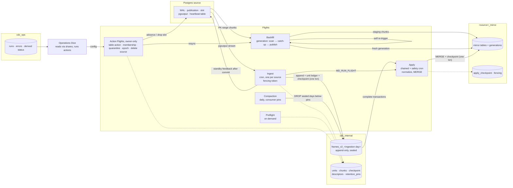
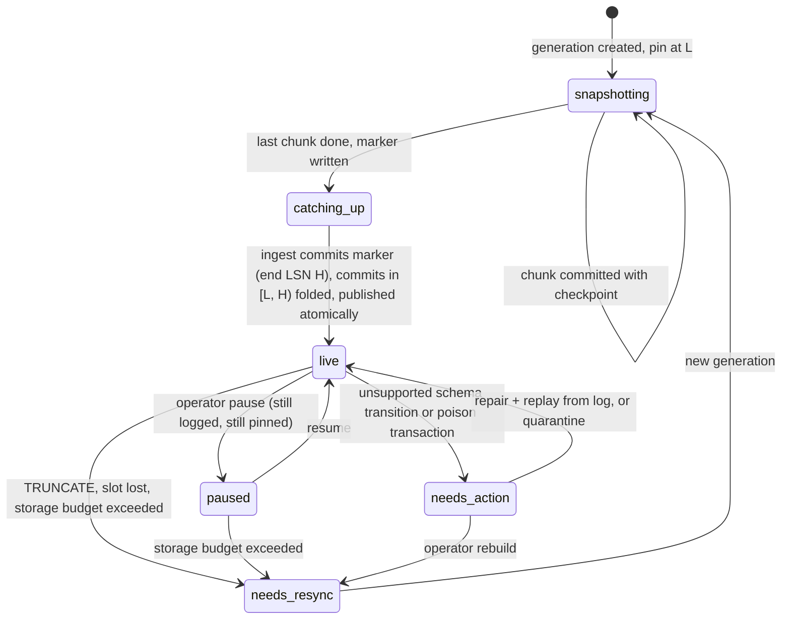

# Postgres → MotherDuck CDC: design doc

## Summary

We will build log-based change data capture from PostgreSQL into MotherDuck using only MotherDuck primitives: Flights for compute, an internal CDC database for the change log and checkpoints, one mirror database per source for mirror tables and apply state, an operations database for derived status, and a Dive for operations. The result is micro-batch CDC with a freshness floor of roughly one to two minutes, not streaming, because a Flight is a triggered process that runs to completion and exits (the default ingest schedule runs every three minutes, for headroom).

Headline decisions:

* **Three scheduled Flights, not one.** Ingest drains the Postgres replication slot into an append-only change log. Apply merges the log into current-state mirror tables with pure SQL. Compaction keeps the log bounded. Backfill and operator actions are on-demand Flights.
* **The change log is the contract.** Ingest never touches mirrors; apply never touches Postgres. The log is also the replay source, the audit trail, and the thing that makes every step idempotent.
* **Change log as per-day MotherDuck tables.** `cdc_internal.<source>.frames_v2_<yyyymmdd>`, keyed by ingestion day and sealed before being dropped, so retention is DROP TABLE under explicit consumer pins rather than DELETE.
* **Slot first, then generation-based backfill.** The replication slot is created before any table is read; each initial load or resync is a generation built in a fresh staging mirror from PK-range chunks, caught up to an end marker observed in the log, and published atomically with its checkpoint. No per-chunk watermarks. (An append table's snapshot is the exception: one exported snapshot; see dev-docs/backfill.md.)
* **A heartbeat table in the publication**, so a quiet source on a busy cluster cannot pin WAL for everyone else.
* **Four explicit protocols carry the guarantees.** Durable transaction ingestion (event identity, deterministic batches, a checkpoint advanced only through complete transactions), generation-based backfill, single-database apply and publication (every correctness-critical transaction writes one MotherDuck database), and retention driven by consumer pins with fencing tokens. The guarantee is per-table consistency, not cross-table atomicity.

## Goals and non-goals

v1 replicates a set of PostgreSQL tables into MotherDuck with inserts, updates and deletes, survives Flight restarts without losing or duplicating a change, and gives an operator a single screen to see lag, errors and backfill progress.

Goals:

* Log-based capture via pgoutput; freshness measured in minutes.
* Initial load and per-table resync that can span multiple Flight runs.
* Exactly-once effect on each mirror table at its advertised boundary; at-least-once into the change log with deduplication by event identity.
* Additive schema evolution (new columns) handled automatically; everything else surfaced as an error, never guessed.
* Bounded storage on both sides: WAL on the source, change log on MotherDuck.
* A fallback mode (watermark or xmin polling, from the cookbook Flight) for sources where the DBA will not enable wal_level = logical; designed for, deferred past v1.
* Runs entirely on a customer's MotherDuck account; no infrastructure outside MotherDuck and Postgres.

Non-goals for v1:

* Sub-minute latency or a long-lived streaming process.
* Per-chunk correctness during a backfill (per-chunk watermarks). A table is published only after its catch-up through an end marker completes.
* UPDATE and DELETE on tables without a primary key or replica identity index. Such a table is captured insert-only (append mode): an UPDATE holds it, and a DELETE holds it unless `ignore_deletes` is set.
* DDL beyond ADD COLUMN: renames, drops, type changes and primary-key changes require an operator action.
* Cross-table transaction consistency: the guarantee is per table. Multiple consumers of one slot, or multiple slots per source database.
* Sources other than PostgreSQL 13+ (10 to 12 are possible but lose partitioned-table publication and schema-level publications).

## Background: how Postgres logical replication works

Every committed write already lands in the cluster-wide write-ahead log (WAL). With wal_level = logical, Postgres can decode that log back into row-level inserts, updates and deletes. Four server-side objects make the stream consumable; the consumer owns nothing on the server except a cursor position.

| Object | Lives | What it is | Who creates it |
| :---- | :---- | :---- | :---- |
| WAL | Postgres cluster, on disk | One ordered byte stream for every database on the server. Positions in it are LSNs. | Postgres |
| Publication | Postgres, catalog of one database (pg_publication) | The list of tables and operations to publish. Metadata only. | Table owner or superuser, once |
| Replication slot | Postgres cluster, persisted in pg_replslot/ (pg_replication_slots) | A named cursor into the WAL, bound to one database. Postgres retains WAL from the slot's restart_lsn until the consumer confirms past it. | DBA or the preflight Flight, once |
| Output plugin (pgoutput) | Inside the WAL-sender process Postgres spawns per replication connection | Decodes WAL, filters to the publication, streams Begin / Relation / Insert / Update / Delete / Commit messages. Built in since Postgres 10. | Postgres |
| Consumer | The Ingest Flight | Opens a replication-protocol connection (START_REPLICATION SLOT … LOGICAL), parses pgoutput, sends standby-status feedback with the LSN it has durably processed. | Us |

**LSN** (Log Sequence Number) is a 64-bit byte offset into the WAL, written as 0/75A1F8A1. It is global to the cluster, so it orders every change across all databases and tables. A slot's state is two LSNs: confirmed_flush_lsn (what the consumer has acknowledged) and restart_lsn (the oldest WAL still needed, which lags when a long transaction is open). The consumer's checkpoint is a single LSN per slot, not per table.

**Consistency of an initial load.** When a slot is created, Postgres records the current LSN. Everything committed after that point is held by the slot and decodable later, so creating the slot before reading any table is necessary. It is not sufficient: a chunk read at time T2 may already reflect a change that ingest has not yet logged, so a table is consistent at an advertised checkpoint only after every change up to a catch-up boundary observed after the last chunk has been folded in. Protocol 2 in the Correctness section makes that boundary explicit.

**Scope.** One slot drains every published table in one database. Two databases on the same cluster need two slots, each tracking its own position in the shared WAL. A slow consumer on a quiet database still retains WAL generated by other busy databases on that cluster.

## Platform constraints

The design is shaped by five properties of Flights, MotherDuck and Dives. Each one closes off a familiar CDC pattern and forces a specific choice.

| Constraint | Source | Consequence for the design |
| :---- | :---- | :---- |
| A Flight is a triggered process: it runs python main.py to completion and exits; a run starts from a cron (five-field, UTC, per-minute at best) or MD_RUN_FLIGHT | [Flights concepts](https://motherduck.com/docs/concepts/flights/), get_flight_guide | No long-lived replication connection. Ingest is a micro-batch that drains the slot and exits; freshness floor is the cron interval plus run startup. |
| Maximum runtime per run: 1 hour on Lite, 8 hours default on Business/Enterprise; concurrent runs unlimited on paid plans | [Flights concepts](https://motherduck.com/docs/concepts/flights/#availability-and-plan-limits) | Backfills must be chunked and resumable across runs. Ingest must cap its own runtime on a backlog. Two scheduled runs can overlap, so ingest needs a lease. |
| Runtime: 2 vCPU / 16 GB (F16 default), 150 GB /tmp, any PyPI package via requirements.txt, DuckDB pinned to the MotherDuck-supported version, git preinstalled | get_flight_guide | pgoutput parsing and the log append run on two cores; this is the ingest ceiling (dev-docs/performance.md). Local DuckDB plus md: connection is the load path. |
| Outbound connections come from fixed per-region egress IPs; Flights connect over IPv4; no inbound | [Flights: connecting to external systems](https://motherduck.com/docs/concepts/flights/#connecting-to-external-systems) | Customers allowlist two IPs per region. Supabase direct hosts need the IPv4 add-on; connection poolers are rejected by preflight. |
| Config is a {string: string} map exposed as environment variables; secrets are separate TYPE flights objects; a run can only override config keys the Flight already declares; every run uses the owner's token and secrets whoever starts it | get_flight_guide | Postgres credentials live in a Flights secret. Every operational knob is declared on the Flight with a default of "". Table-level settings live in cdc_internal.tables, changed from the Dive through action Flights without a new Flight version. Dive-triggered actions validate every config value as untrusted input. |
| MotherDuck write guidance: avoid row-by-row INSERT (50 to 100 ms per round trip); stage 10 to 100 MB batches via Parquet or read_json_auto; CREATE SNAPSHOT makes writes visible to share readers immediately but blocks writes while it runs; shares otherwise update within about a minute | get_flight_guide | Log appends bulk-load in-memory Arrow. Backfill chunks, and batches the Flight folds, stage through a local Parquet file read by one INSERT or MERGE. Apply never runs CREATE SNAPSHOT; an action Flight runs one on the operations database after its audit copy. |
| The DuckDB postgres extension and MERGE INTO work from a Flight's DuckDB client against MotherDuck tables; server-side ATTACH of Postgres is unsupported | [Cookbook: flight-postgres-ingest](https://motherduck.com/docs/cookbook/flight-postgres-ingest/) | The fallback (watermark) mode and the apply step are both plain SQL from the Flight. |
| A Dive cannot write to a database; it runs a Flight the owner granted RUN on and passes viewer input as config | get_flight_guide, Dive guide | Every operator action is a small on-demand Flight with validated config keys and idempotent effects. |

## Architecture overview



The top row is the steady-state path: Postgres streams decoded changes to the Ingest Flight, which appends them to per-day change-log tables; the Apply Flight merges complete transactions into mirror tables. Backfill writes into the same log and publishes a generation only after catching up to an end marker. Each Flight writes one database per transaction, the internal CDC database or a source's mirror database; the Dive reads derived status through a share and starts action Flights with validated config. Compaction removes only sealed day tables below every retention pin.

## Component design

Five pipeline Flights per source (preflight, backfill, ingest, apply, compaction) and five action Flights, one internal CDC database, one mirror database per source, an operations database, and one Dive. How they are built, deployed and chained is in docs/flights.md.

### Preflight Flight (on demand)

Validates a source before anything is created and writes its result and warnings to cdc_ops.preflight_status, so the Dive shows the setup check. Checks: wal_level, free max_replication_slots and max_wal_senders, role has REPLICATION and SELECT, slot and publication exist or can be created, per-table primary key or replica identity, TOAST-prone columns without REPLICA IDENTITY FULL, publication features that change what pgoutput sends, the session settings the casts rely on, max_slot_wal_keep_size, and pooler hosts; it warns to verify failover slot synchronization separately. Creates slot, publication and heartbeat table when create_objects is set and privileges allow; otherwise emits the exact DDL for the DBA.

### Backfill Flight (on demand, chunked, resumable)

Each backfill is a generation. It refuses to start unless an ingestion checkpoint exists. It records the current committed ingestion boundary L as its pin, creates a fresh staging table `<table>__gen_<id>` in the mirror database with the source's current key as its PRIMARY KEY, and reads the table in key-range chunks (WHERE ROW(key) > ROW(last) ORDER BY key LIMIT n, bounded by rows and bytes). Each chunk is inserted directly into staging and committed together with its resume key, so a run killed by the timeout redoes at most one chunk. Snapshot rows never enter the change log. Before every chunk, and again once the end marker is durable, it checks that the source columns and key still match the generation, and fails the generation if they don't. After the last chunk it writes a unique marker to the heartbeat table and waits for ingest to commit that transaction, whose end LSN is H. It then folds the logged changes with commit LSN in [L, H) into staging, and publishes the generation atomically with the apply checkpoint at H. Generation states: snapshotting, catching_up, then published (later replaced), failed or abandoned. Multi-run backfills resume unattended: the Flight re-triggers itself with MD_RUN_FLIGHT until the generation is published.



### Ingest Flight (cron, one per source)

1. Acquire the ingest fencing token for the source with an expiry; exit if a newer token exists.
2. Read the ingestion checkpoint from the source row and the slot's restart_lsn, confirmed_flush_lsn, wal_status and safe_wal_size from pg_replication_slots; fail if the slot's confirmed position is ahead of the checkpoint.
3. Write the heartbeat marker, then open the replication connection (protocol version 1\) from the checkpoint. Parse pgoutput; spool events into bounded physical chunks, which may split a transaction; record a manifest per transaction. On a Relation message whose column set differs, write a new schema descriptor and stamp its version on every following event for that relation. Keep answering keepalives while writing.
4. At the upload byte/item limit or flush interval, append Arrow frames to `frames_v2_<ingestion day>` with deterministic chunk identities, immutable descriptors and the unit ledger. In the same fenced transaction advance the checkpoint only through the last complete unit END. Only then send feedback. Upload cuts do not change chunk or unit identity.
5. Stop at the runtime cap or when the slot is drained through the marker. Release the token. After a run whose durable checkpoint advanced, start the apply Flight with MD_RUN_FLIGHT (best effort; apply's safety cron covers a failed trigger).

If the run dies after step 4's commit but before feedback, or the commit succeeds and the response is lost, the next run re-reads the same WAL; the deterministic batch_id and the event identity make the re-append a no-op.

### Apply Flight (chained after ingest, plus a safety cron)

Pure SQL on MotherDuck, one transaction per table on the mirror database. For each table with state = 'live': take the apply fencing token; select contiguous complete units above applied_through_lsn, bounded by the captured high, reading only their physical frame days. Checkpoints and poison holds remain whole-unit boundaries. Reconcile schema: a schema_version not yet applied to the mirror becomes ALTER TABLE ADD COLUMN when the change is additive; any other transition sets the table to needs_action and skips it. Normalize into complete row images in commit order (fold partial updates, distinguishing unchanged-TOAST, SQL NULL and absent; split a changed identity into delete-old-key plus upsert), then reduce to the latest image per key:

```sql
SELECT * FROM normalized
QUALIFY row_number() OVER (PARTITION BY key ORDER BY commit_lsn DESC, event_ordinal DESC) = 1
```

Then one MERGE INTO `<mirror>` with insert, update, and delete when the last image is a delete (deletes are hard deletes). For the common format-2 batch (one schema version and key layout, no key change, no blocking event) the normalization fold runs in SQL inside the MERGE's source, reading the stored frames where they are (`sql_fold.py`); any other batch is folded in the Flight over bounded batches of complete units, with the same semantics. The fold contract therefore has two implementations, `mirror.fold` and `sql_fold`, held equal by permanent differential tests; see dev-docs/apply.md. applied_through_lsn advances in the same transaction as the merge, conditional on the fencing token. The guarantee is per-table: a join across two mirrors may see different boundaries.

### Compaction Flight (daily)

Candidate days are sealed frame_partitions_v2 whose touching units resolve below every retention pin for the source (live, paused and errored tables, active generations, replay jobs). For each: take the compaction token, DROP TABLE, mark the partition dropped. Consumers that have not advanced within the source's storage budget or maximum retained lag are moved to needs_resync with the gap recorded and their pins released; nothing is dropped while a pin holds it.

### Action Flights (on demand, run from the Dive)

Each declares its inputs as config keys with "" defaults, validates them against allowed values, resolves
targets from registered objects (never from free-form input), and is safe to repeat. Every one is owner-only
(no RUN grants), starts with a dry run, and needs that preview's typed confirmation for a destructive step.
docs/operations.md, "Action Flights", has the inputs and refusals.

| Action Flight | Actions | Guard |
| :---- | :---- | :---- |
| table-action | pause, resume, retry, resync, resync-all, start-snapshot, start-from-log (append tables), accept-types, compact-now | The table's expected state; resyncs start the backfill Flight, whose run takes the generation lease |
| table-membership | add (keyed or append), remove | Holds the source's PostgreSQL secret (as epoch and delete-source do; table-action and quarantine never do); never alters the publication |
| quarantine | Skips one whole unit for one table's generation and records the gap | Apply lease for that table; the unit named in the confirmation |
| epoch | recover-slot (a lost, missing or ahead slot), skip-to-lsn; both begin a new source epoch, and every table needs a resync | Exclusive ingest lease |
| delete-source | Drops the slot, publication and heartbeat; marks the source deleted, for good. Mirrors and the log are kept | The one action that drops the slot |

### Operations Dive

Reads cdc_ops, cdc_internal and the mirrors through shares; read-only for every viewer but the owner. Screens
(docs/dive.md): an overview of sources and tables, problems first; a source page with the pipeline, slots and
retained WAL, retention pins and the setup check; a table drawer with status, fix options, backfill progress,
gaps and quarantines, and action history; read replica and PostgreSQL TLS cards. The owner runs the action
Flights from it. It is not an alerting channel: it warns when ingest hasn't succeeded for a while, but no
Flight pushes alerts (a notifier is deferred).

## Data model

Three kinds of MotherDuck database, chosen so that every correctness-critical transaction writes exactly one of them: cdc_internal (change log, batch manifests, ingestion checkpoints, schema history, retention pins; shared across sources), one `<source>_mirror` database per source (mirror tables, apply checkpoints, generation state, fencing state), and cdc_ops (derived status for the Dive; eventually consistent).

### Change log: `cdc_internal.<source>.frames_v2_<yyyymmdd>`

One append-only table per UTC ingestion day, with the fixed format-2 Arrow schema.
EVENT and COMMIT frames carry source epoch, unit start and exclusive frame ordinal,
commit LSN/time/transaction identity, binding/config/mapping revisions and wire
length. Old/new images and key projections are nullable structs containing aligned
text-value and kind lists: SQL NULL, unchanged TOAST, absent and empty images stay
distinct. TRUNCATE retains all referenced OIDs and their immutable descriptors.
Values remain structured text here; typed mirror casts happen in apply.

Raw received wire bytes plus the versioned header feed the digest, never a hot-path
row reconstruction or a JSON payload. Charged bytes include the 8-byte ordinal,
frame header and received wire bytes. Chunks close by frame count/charged bytes;
units group complete commits, default at most 100, with byte/delay targets.
Relation/Type/Origin messages are session context and never shift frame ordinals
or boundaries. See [log-format.md](log-format.md#durable-contract-format-2) for binding,
chunk identity, replay and resources. Format 1 is historical test evidence only;
legacy stores require approved recreation and full re-backfill.

### Mirror: `<source>_mirror.<schema>.<table>`

Typed columns from the Relation message plus _cdc_commit_lsn and _cdc_updated_at; a keyed table has a primary key on its replica identity. An append table has no primary key and adds _cdc_event_ordinal. Each mirror table has a current generation; a resync builds `<table>__gen_<id>` as staging and publishes it atomically with the checkpoint. Apply checkpoints, generation state and fencing tokens live in this database, next to the tables they guard.

### Metadata tables and where each lives

| Table | Database | Contract |
| --- | --- | --- |
| source, source_epochs | log source schema | One changing guard/lease and durable confirmed END; immutable epoch start, requested/actual skip and abandoned-unit audit |
| protocol_v2, unit_configs_v2 | log source schema | Recorded text-output binding, mapping and immutable unit revisions |
| units_v2 | log source schema | Ordered complete-unit END/digest/member count or an explicitly abandoned prefix |
| chunks_v2 | log source schema | Deterministic ordinal ranges, digests/chains, ordered descriptor keys and exact physical day |
| frame_partitions_v2 | log source schema | Per-day/epoch bounds, charged bytes and active/sealed/dropped state |
| descriptors_v2 | log source schema | Immutable relation/schema/key-layout descriptors |
| tables, key_changes | log source schema | Membership and deferred ordered key activation at verified complete cuts |
| retention, retention_pins | log source schema | Strict floor and guarded consumer/generation pins |
| apply_state, generations, backfills, quarantine, previews | mirror _cdc schema | Per-table fencing/checkpoint, resumable snapshot publication and whole-unit action confirmations |
| status/run/audit tables | ops | Derived status, v2 unit/partial fields and leased conflict outcomes; never correctness authority |

The log append, ledgers and ingest checkpoint commit in ONE log transaction. MERGE
and apply checkpoint commit in ONE mirror transaction. Publication and generation
state share that mirror transaction; cross-database pin movement uses the safe
order that leaves extra protection after a crash. No correctness-critical write
transaction spans two databases. The Dive reads ops shares, never source secrets.

## Correctness

The design makes four explicit protocol commitments. Together they give an exactly-once effect on each mirror table at that table's advertised boundary. They do not give cross-table atomicity, and this section says so rather than implying it.

### Protocol 1: durable grouped ingestion

The persisted protocol is format 2. Wire event identity is source/epoch/commit LSN
and event ordinal; physical identity additionally binds unit start, frame range,
configuration and cell mapping. A unit may contain several complete transactions;
chunks may split one transaction. EVENT and COMMIT received bytes plus headers are
hashed, and the final unit digest/count closes the chain. Retries compare exact
identities, descriptor order, digest/chain and server-side physical row counts,
including ledger-missing ranges. They never append the same frames twice.

Only contiguous complete units advance the checkpoint, atomically with the frames
and metadata. Feedback is the last complete unit's transaction END, never a commit
start, durable partial prefix or server WAL. An ambiguous response is resolved by
durable replay. A crash after terminal commit but before feedback restarts at that
explicit durable END even when the slot lags. Open-unit recovery must reproduce
its immutable prefix; session-scoped metadata never changes replay boundaries.

Ingest pipelines one upload with next-batch decoding, preserving collect → fence →
ack → submit. Only the worker uses the destination connection during append. The
source fence always changes the same guard column via plain UPDATE, never an
unchanged-value write or UPDATE RETURNING. Failed transactions escape before any
COMMIT; bounded cleanup settles the worker before release/status. A tagged
compaction conflict reports busy without own progress or conflict with own
complete-unit progress; later writers cannot advance this run's reported boundary.

Text-output GUCs, encodings, extension versions and mapping revision are recorded
and verified on the replication session. An incompatible mapping/config/binding
cannot extend a durable prefix. Protocol changes require an approved version and
cutover plan plus golden/recovery evidence; editing a stored binding is forbidden.

### Protocol 2: generation-based backfill

Every initial load and resync is a generation with its own generation_id and a fresh staging table; it never merges into an existing mirror, so a row deleted while the slot was invalid cannot survive a resync. Before scanning, the Backfill Flight records its pin at a committed ingestion boundary L, validated against the active source epoch and durable ingestion checkpoint. It reads the table in key-range chunks; each chunk and its checkpoint commit together in the mirror database, so a killed run redoes at most one chunk. Chunk size bounds redo work, not acceptable loss.

After the final chunk it writes a unique marker to the heartbeat table and waits until ingest has completed the unit containing that marker; that unit's last transaction END is H. Every chunk read happened after L and before the marker committed. So the initial mirror is the snapshot plus every logged change for the table with commit LSN in [L, H), folded with the same normalization apply uses: the last change wins for each key, and rows untouched in the range keep their snapshot values. The lower bound is inclusive because a commit record can start exactly at the previous transaction's end LSN. Only then is the generation published, in one mirror-database transaction: DROP TABLE of the current mirror, RENAME of the staging table, the apply checkpoint set to H, and the generation states updated. A compare-and-set guards it, under both the generation lease and the table's apply lease. CREATE OR REPLACE TABLE AS SELECT is not used, because it drops the PRIMARY KEY. A delayed Flight from an abandoned or replaced generation cannot write into its replacement, because its lease and generation state no longer match.

Reading before the slot exists is still the one unsafe ordering. Without the catch-up boundary, a chunk read after a change that ingest has not yet reached would expose a state that never existed at the advertised checkpoint, which is why creating the slot first is necessary but not sufficient.

### Protocol 3: single-database apply and publication

Every correctness-critical transaction writes exactly one MotherDuck database. The internal CDC database holds the log, chunk/unit ledgers, ingestion checkpoints, immutable descriptors and retention pins. Each source's mirror database holds its mirror tables, per-table apply checkpoints (source_epoch and transaction_end_lsn), generation and publication state, and apply fencing state. A shared operations database holds derived status for the Dive and may be eventually consistent. DuckDB's documented transaction model permits writes to one attached database per transaction, and MotherDuck has not been established to offer more, so the layout assumes nothing stronger.

Apply, per live table: select complete units above the table's checkpoint and below the captured head.high; normalize them into complete row images in commit order, folding partial updates so the latest explicitly supplied value per column wins, treating unchanged-TOAST, SQL NULL and column-absent-in-this-schema-version as three distinct states, and turning a changed replica identity into a delete of the old key plus an upsert of the new key; then reduce to the latest image per key and MERGE. The checkpoint advances in the same transaction as the merge. Rerunning any range yields the same mirror.

The guarantee is per-table consistency: each table advertises its own processed boundary, and a query that joins two mirrors may observe different boundaries. Source-wide consistency, where all affected mirrors advance to a common transaction boundary atomically, is deferred; it would make one table's error block source-wide progress.

### Protocol 4: retention with fencing

Every mutating Flight run acquires a monotonically increasing fencing token using database time only if the prior lease is absent or expired; an overlapping run exits while the current lease is valid. Successful or exceptional run exits release the lease in a finally block using its token; a stale release cannot unlock a newer holder. Guarded writes renew the configured TTL using database time. After a process crash without release, takeover waits for that TTL to expire (900 seconds), longer than the longest gap between guarded writes. Tokens are scoped (ingest per source, apply per table, backfill per generation, compaction per source), and every mutation is a conditional write that validates the current token in the same transaction. A stale worker that resumes after its lease expired cannot commit. Token acquisition and every guarded mutation update the same guard column in the transaction; reading a token and writing another column is insufficient under column-level conflict handling. Every fence is an ordinary UPDATE plus an affected-row check, never UPDATE RETURNING (dev-docs/invariants.md). Skip-to-LSN takes the same exclusive token as ingest, so checking for a lease and then acting is never a race; compaction holds its own `compact:<source>` token.

Retention is driven by explicit consumer pins, not by table state. A generation registers its pin in cdc_internal before scanning; a pin advances only after the mirror checkpoint commits. A crash between these commits retains extra history. Pin registration and compaction mutate a shared guard; a retention floor rejects requests for already-dropped history. Readers include commits at their lower bound, so the floor rejects a pin at or below the highest dropped commit (strictly). Raising a pin cannot make a drop unsafe, so steady-state advances skip the guard; they are fenced on the pin's generation instead. Missing expected pins fail closed. Publication atomically transfers the generation pin to a table pin after the mirror commit; steady-state apply advances that table pin after its commit, including quiet ranges. Abandoned-generation pins are released only after abandonment commits. Checkpoints, pins, partition bounds and the retention floor are ordered by (source_epoch, LSN), so a newer replication history may restart at a lower LSN. An explicit token-guarded epoch transition precedes ingestion from a recreated source; existing mirrors require a new generation. Live, paused and errored tables, active generations and replay jobs each hold a pin at the oldest boundary they still need, and a quiet table advances its processed-through boundary even when no event affects it, so it cannot pin the log forever. A day partition is sealed before it is dropped, and partitions are keyed by ingestion day with commit time kept as data, so a late or re-read batch never writes into a sealed day. Bounded storage, indefinite pause and lossless resume cannot all hold at once: each source has a storage budget and a maximum retained lag, and a consumer that exceeds them moves to needs_resync with the gap recorded.

### What the log cannot guarantee

Changes to unpublished tables, sequences, DDL statements and large objects are not captured. TRUNCATE is published and detected: apply moves the table to needs_resync when it arrives rather than ignoring it. Defaults filled into existing rows by ADD COLUMN with DEFAULT generate no WAL: ingest's per-run catalog check (atthasmissing) holds the table for a resync. Postgres does not replicate DDL as events, so periodic catalog rediscovery is still needed for tables that are otherwise quiet.

## Replica capture (a read replica as the source)

A source can be a **read replica (standby)**: a physical
streaming replica, PostgreSQL 16+, with `CDC_HEARTBEAT_WRITER=external`. Setup, diagnostics and
runbooks: [docs/read-replica.md](../docs/read-replica.md). The design:

- **Scope.** The Flights connect only to the read replica; the DBA sets up the primary once (the
  heartbeat table, the publication and a scheduled heartbeat upsert, which is liveness only).
  Format 2, frames, digests and the binding are unchanged, and a primary source's behaviour is
  unchanged byte for byte.
- **Mode.** `self` (default; a primary) or `external` (a read replica), recorded on the source
  row and on each generation (`finality_mode`); a mismatch with config is refused. A read
  replica with `self`, or a primary with `external`, is refused.
- **Rule U.** For a replay position B sampled on the read replica, the first durable complete
  unit with `end_lsn > B` (its end is H) contains, with the units before it, every transaction
  whose commit was replayed at B. The comparison is **strict**: redo of a commit can make it
  visible before the replay pointer moves past its record (checked in PostgreSQL 16–18).
- **Ingest** samples B under the lease after the slot check, writes no heartbeat, and drains at
  the first unit ending past B; otherwise the run caps with its checkpoint unmoved.
- **Keyed backfill** reads the replay position after each chunk's snapshot and persists the
  highest with the chunk; B is that bound after the scan, H the first unit past it. **Append
  backfill** takes B on the session that imported the exported snapshot (≥ C). No marker row
  is written. Recovery conflicts: a keyed chunk is retried (bounded); an append copy fails.
- **Identity.** System id and timeline are checked against the registered source (ingest each
  run, backfill once per run, epoch). **A generation fails, not holds** when the replay position goes backwards, the source is no longer a read
  replica, or its identity or timeline changes; failover is not supported.
- **Slots.** Creation on a read replica waits for the primary's standby snapshot: bounded
  (`CDC_SLOT_WAIT_SECONDS`), reported `waiting_for_primary`, retryable. A slot invalidated by a
  recovery conflict is detected from `pg_replication_slots` columns, never error text.
- **Diagnostics** (replay and receive positions, lag, upstream contact, the heartbeat's
  freshness) are advisory: never an input to a decision.
- **Packaging.** The read replica's backfill code (`standby_backfill`) is imported lazily, only for
  a read replica source.

## Schema evolution and type mapping

Additive change is automatic; every other transition is unsupported, detected, and surfaced for action. Each event carries the schema_version it was decoded under, so a batch that spans a Relation change applies correctly.

### DDL support matrix

The matrix, as tested, is in docs/tables.md, "Source DDL": what each kind of source DDL does to its table, and
what the operator does. Its tests are listed in dev-docs/test-map.md, "Source DDL matrix". In short: ADD
COLUMN is applied; ADD COLUMN … DEFAULT on existing rows writes no WAL, so ingest's catalog check holds the
table for a resync, as it does for a primary key change and ATTACH/DETACH PARTITION; a type change,
RENAME COLUMN or DROP COLUMN holds it `needs_action`; TRUNCATE holds it `needs_resync`; a dropped, renamed or
replaced table holds alone while the rest of the source runs. The mirror column is never widened in place.

### Type mapping

Values stay PostgreSQL text in the log; apply casts them in the MERGE (`mirror.duck_type`, `mirror.cast_sql`).
A value the mirror type can't hold fails the cast and holds the table; nothing is coerced.

| Postgres | MotherDuck mirror | Note |
| :---- | :---- | :---- |
| smallint, integer, bigint, oid | BIGINT |  |
| real, double precision | DOUBLE | A float key folds by canonical value (dev-docs/apply.md) |
| numeric(p,s), p up to 38 and 0 ≤ s ≤ p | DECIMAL(p,s) |  |
| numeric without a typmod, above 38 digits or with a negative scale | VARCHAR (the exact text) | Never a lossy DECIMAL |
| boolean | BOOLEAN |  |
| date, time, timestamp, timestamptz | DATE, TIME, TIMESTAMP, TIMESTAMPTZ | Preflight requires DateStyle ISO |
| json, jsonb | JSON |  |
| bytea | BLOB | Preflight requires bytea_output = hex |
| text, varchar(n), char(n), and every other type: arrays, uuid, interval, timetz, network types, enums, domains, ranges | VARCHAR (PostgreSQL's text form) | Length isn't kept, so later widening fits; arrays aren't converted to JSON |
| generated columns | Never captured | Preflight rejects publication settings that would send them (docs/limits.md) |

In the change log every column is tagged value, null, unchanged or absent, so a type change never breaks ingest; it only breaks apply, which is the recoverable place.

## Operational concerns

Most production failures of Postgres CDC are on the source, not the destination. The design treats these as first-class, with a detector and a runbook step for each.

| Concern | What goes wrong | Detector | Mitigation |
| :---- | :---- | :---- | :---- |
| WAL retention | Slot not consumed; WAL fills the source disk, or max_slot_wal_keep_size invalidates the slot and forces a full resync | Retained bytes from restart_lsn, safe_wal_size, wal_status and invalidation reason, disk headroom, recent WAL generation rate. LSN distance is bytes, not elapsed time | Ingest on a short cron; the slot's WAL budget and the MotherDuck log budget are sized separately; preflight recommends max_slot_wal_keep_size with long transactions in mind |
| Idle slot | Captured tables quiet, other tables busy: slot cannot advance | Lag grows with zero rows ingested | Heartbeat marker written before the drain boundary and consumed in the same run |
| Long-running transaction | restart_lsn pinned while confirmed_flush_lsn advances; WAL retained; too-low max_slot_wal_keep_size invalidates the slot | confirmed_flush_lsn - restart_lsn gap, shown in the Dive | Past a 1 GiB gap, ingest records the oldest open transaction's age (pg_stat_activity) for the Dive |
| Failover / major upgrade | Slot is lost on the promoted standby or new version | Slot missing on connect | The epoch Flight's recover-slot begins a new epoch; every table needs a resync. Preflight warns to verify failover slot synchronization separately. A read replica source refuses promotion and failover |
| Slot invalidation | pg_replication_slots.wal_status = 'lost' | Connect error; wal_status check each run | source_epoch increments; every table moves to needs_resync; new generations are built |
| Connection poolers | PgBouncer / Supavisor do not speak the replication protocol | Preflight rejects pooler hosts and ports (6432, 6543) | Direct host only; IPv4 required |
| Egress allowlisting | Customer firewall blocks the Flight | Preflight can't connect | Two fixed IPs per MotherDuck region |
| TOAST | Unchanged large values are omitted from updates, distinct from SQL NULL | Preflight rejects a table with TOAST-able columns unless REPLICA IDENTITY FULL is set | FULL is required on such tables; normalization still tags unchanged, null and absent separately and folds partial updates in order, proven against protocol fixtures |
| Keyless tables | Publishing UPDATE or DELETE for a table without replica identity makes those statements fail on the source itself | Preflight | Insert-only capture (append mode): the DBA sets REPLICA IDENTITY FULL so the source accepts UPDATE and DELETE; an UPDATE holds the table, a DELETE holds it unless `ignore_deletes` is set |
| Overlapping runs | Two ingest runs on one slot; a stale worker resumes after its lease expired | Fencing token; Postgres slot is active | Monotonic token validated in every mutation in the same transaction; a stale worker cannot commit |
| Poison transaction | A change apply cannot load (type change, NOT NULL, bad value) | Table in needs_action with the transaction identified | Repair and retry from the retained log, quarantine its whole unit with a recorded gap, or resync. Never fixed by advancing the Postgres slot |
| Change log growth | Unbounded if compaction is off, or pinned forever by a paused table | frame_partitions_v2 charged bytes per day and retention pins in the Dive | Daily compaction with consumer pins and a storage budget; drop whole sealed days; expired consumers move to needs_resync |
| Large transactions | One transaction exceeds batch, memory or runtime bounds | Unit incomplete at run end; repeated restart of the same transaction | Spool bounded in-memory Arrow chunks; apply only complete units; a transaction cap (1 GiB by default) that stops the source at that transaction with `needs_action:large_transaction` rather than looping (docs/limits.md) |
| Operator authority | Every action runs with the Flight owner's credentials; a confirmation dialog is not authorization | Run grant audit | Every action Flight is owner-only (no RUN grants; the Dive deploy refuses one with a grant), and the destructive ones (skip to LSN, delete source) are separate Flights; identifiers are resolved from registered objects, never from free-form input |
| Alerting | Nobody is watching the Dive when ingest stops | The Dive's time since the last successful ingest run | No pushed alerts: a notifier Flight is deferred |
| Read replica capture | Decoding on a read replica needs PostgreSQL 16+ and hot_standby_feedback = on, else catalog vacuum invalidates the slot | Preflight, and the slot's conflict columns each run | Supported; see Replica capture above and docs/read-replica.md |

The runbooks are in docs/runbooks.md: slot invalidated or missing (R1), poison transaction (R2), paused or stalled past retention (R3), and the others.

## Configuration surface

The connection lives in a Flights secret; operational knobs are Flight config keys, each declared with a ""
default so a run can override it (docs/flights.md, "Config"); what to replicate lives in the registry rows in
cdc_internal, changed by the table-membership Flight or `cdc-flight-tables` (docs/tables.md). Batch sizes,
token TTLs and retry policy are internal. wal_level, max_slot_wal_keep_size, REPLICA IDENTITY FULL and
max_wal_senders are DBA decisions: preflight reports them rather than offering a toggle.

Not built: history mode, soft delete, per-column exclusion, arbitrary backfill filters, the watermark and
xmin fallback, per-chunk watermarks for backfill finality, source-wide transaction consistency, multi-slot
sources, and UPDATE and DELETE on keyless tables. Each brings different correctness semantics.

## Tests

The system is correct if, for any sequence of source writes and any pattern of Flight failures, every
published mirror state equals the source at that table's advertised boundary and no change is lost or applied
twice. dev-docs/test-map.md maps each claim to its tests, and dev-docs/testing.md says how to run them.

## Open questions and risks

Settled: publication is a DROP of the current mirror plus a RENAME of the staging table in one mirror
transaction, never CREATE OR REPLACE TABLE AS SELECT (it drops the primary key); the replication consumer is
a direct copy-both stream on psycopg 3's libpq wrapper with a strict pgoutput v1 decoder, so slot
acknowledgment stays under this design's control (`replication.py`); LSNs are stored as UBIGINT. Open work is
in STATUS.md; the ingest ceiling is in dev-docs/performance.md.

Risks: the source side is the customer's, so WAL retention and failover remain their responsibility however good the detectors are; a long backfill on a busy source needs the DBA to size max_slot_wal_keep_size up front; Flight scheduling at per-minute granularity means a 1-minute cron with a 50-second run is the practical floor; and bounded storage, indefinite pause and lossless resume cannot all hold at once, so an expired consumer moves to needs_resync rather than pinning the log forever.

## References

* [MotherDuck: Flights concepts, plan limits, egress IPs](https://motherduck.com/docs/concepts/flights/)
* [MotherDuck cookbook: Mirror PostgreSQL tables with a Flight](https://motherduck.com/docs/cookbook/flight-postgres-ingest/)
* [MotherDuck: Flight sizes](https://motherduck.com/docs/about-motherduck/billing/flight-sizes/)
* MotherDuck MCP get_flight_guide (runtime, config, secrets, loading guidance, Dive-triggered Flights)
* [PostgreSQL: logical decoding](https://www.postgresql.org/docs/current/logicaldecoding.html) and [logical replication restrictions](https://www.postgresql.org/docs/current/logical-replication-restrictions.html)

* [PostgreSQL: logical replication message formats (Commit LSNs, TupleData unchanged-TOAST marker, Update old key)](https://www.postgresql.org/docs/18/protocol-logicalrep-message-formats.html)

* [PostgreSQL: streaming replication protocol (START_REPLICATION start position rules)](https://www.postgresql.org/docs/current/protocol-replication.html)

* [PostgreSQL: pg_replication_slots view (restart_lsn, safe_wal_size, wal_status, invalidation reason)](https://www.postgresql.org/docs/18/view-pg-replication-slots.html)

* [PostgreSQL: logical replication failover and slot synchronization](https://www.postgresql.org/docs/18/logical-replication-failover.html)

* [PostgreSQL: publications (TRUNCATE publishing, replica identity requirements)](https://www.postgresql.org/docs/16/logical-replication-publication.html)

* [DuckDB: ATTACH transactional semantics (one attached database per write transaction)](https://duckdb.org/docs/1.5/sql/statements/attach#transactional-semantics)

* [Psycopg 3: libpq wrapper (`psycopg.pq`)](https://www.psycopg.org/psycopg3/docs/api/pq.html)
