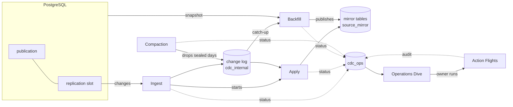

# How it works

Change data capture from PostgreSQL into MotherDuck, using only MotherDuck: Flights for compute, a
change-log database, one mirror database per source, a status database and an operations Dive.

It is micro-batch, not streaming. A Flight is a scheduled process that runs to completion and exits,
so freshness is measured in minutes: the default ingest schedule runs every three minutes, and apply
follows each ingest run.

## The pieces

**On PostgreSQL** (set up once by the DBA; see [setup.md](setup.md)):
- a **publication**: the tables to capture;
- a **replication slot**: a cursor into the write-ahead log (WAL). PostgreSQL keeps WAL from the
  slot's position until ingest confirms it, so an unread slot retains WAL;
- a **heartbeat table** in the publication, so a quiet source on a busy server can still advance its
  slot.

**On MotherDuck:**

| Database | What it holds |
| --- | --- |
| `cdc_internal` | The change log, one table per source per UTC day, with its checkpoints and retention pins. Shared by every source. |
| `<source>_mirror` | One typed table per captured source table, kept current by apply, plus apply's own state in its `_cdc` schema. This is the database you query. |
| `cdc_ops` | Status for the operations Dive: runs, health, held tables. Derived, never authoritative ([operations.md](operations.md)). |

**The Flights:**
- **Ingest** (scheduled) drains the slot into the change log, in whole units of complete
  transactions, then confirms them to PostgreSQL. It never touches a mirror.
- **Apply** (chained after ingest, plus a safety schedule) merges the logged changes into the mirror
  tables. It never connects to PostgreSQL.
- **Backfill** (on demand) loads a table, or reloads it (a resync), from a snapshot, catches it up
  from the log, and then publishes it in one step. It re-triggers itself until done.
- **Compaction** (daily) drops whole sealed log days that no table still needs.
- **Preflight** checks the source before anything is created; the **action Flights** (pause, resume,
  retry, resync, quarantine, add or remove a table, recover a lost slot, delete a source) are run by
  the owner from the Dive.

[flights.md](flights.md) covers building, deploying and chaining them.

## Data flow

Ingest is the only Flight that reads the slot, and apply never connects to PostgreSQL. A backfill
reads PostgreSQL directly, for its snapshot. The states a table moves through are in
[tables.md](tables.md#table-states).

## What is guaranteed

- **Per table, exactly once.** Each mirror table equals the source table as of its checkpoint: every
  change up to that point is applied once, in commit order. A Flight that crashes and reruns doesn't
  lose or duplicate a change.
- **Per table, not across tables.** Two tables' checkpoints can differ, so a query that joins mirror
  tables can see one table further ahead than the other.
- **Nothing is guessed.** A change apply can't load (an incompatible type change, a value the mirror
  type can't hold) holds that table, alone, for an operator action; other tables and ingest go on.
  See [tables.md](tables.md) and [runbooks.md](runbooks.md).
- **The slot advances only past what is durable** in the change log, never past what PostgreSQL has
  merely sent.

## What the log can't capture

- Changes to unpublished tables, sequences, DDL statements and large objects.
- `TRUNCATE` is captured and detected: the table moves to `needs_resync`.
- Defaults filled into existing rows by `ADD COLUMN ... DEFAULT` write no WAL. Ingest's per-run
  catalog check detects it and holds the table for a resync.
- PostgreSQL doesn't replicate DDL, so schema changes reach the mirror only through the column list
  of the next change to that table. What each kind of DDL does is in
  [tables.md](tables.md#source-ddl).

## Types in the mirror

| PostgreSQL | Mirror column |
| --- | --- |
| smallint, integer, bigint | BIGINT |
| real, double precision | DOUBLE |
| numeric(p,s), with p up to 38 | DECIMAL(p,s) |
| numeric without precision, above 38 digits, or with a negative scale | VARCHAR (the exact text) |
| boolean | BOOLEAN |
| date, time, timestamp, timestamptz | DATE, TIME, TIMESTAMP, TIMESTAMPTZ |
| text, varchar(n), char(n) | VARCHAR (the length isn't kept, so later widening fits) |
| json, jsonb | JSON |
| bytea | BLOB |
| arrays, uuid, interval, network types, enums, domains, ranges and other types | VARCHAR (PostgreSQL's text form) |
| generated columns | never captured ([limits.md](limits.md)) |

Every mirror table also has `_cdc_commit_lsn` and `_cdc_updated_at` (the source commit time). A
keyed table has a primary key on its replica identity. An append (insert-only, keyless) table has no
primary key, so duplicate rows stay, and has `_cdc_event_ordinal` beside the commit LSN, so the two
name every row; a row loaded from the snapshot has no commit LSN or commit time. A value PostgreSQL accepts but the mirror type can't
hold (such as `NaN` in a `numeric(p,s)` column, or a BC date) holds the table rather than being
coerced.

## What to watch on the source

| Concern | What goes wrong | What to do |
| --- | --- | --- |
| WAL retention | An unread slot retains WAL: the source disk fills, or `max_slot_wal_keep_size` invalidates the slot and every table needs a resync | Keep ingest running; watch retained bytes in the Dive; runbook R1 |
| Long-running transactions | An open transaction holds back the slot's restart position, so WAL is retained | The Dive shows the gap; end the transaction |
| Failover or a major upgrade | The slot doesn't survive on the new server | Recover with the epoch Flight, then resync ([runbooks.md](runbooks.md)) |
| Connection poolers | PgBouncer and similar poolers don't speak the replication protocol | Connect to the server directly |
| TOAST | Unchanged large values are omitted from updates | Preflight requires `REPLICA IDENTITY FULL` on tables with TOAST-able columns |
| Large transactions | One transaction larger than the cap (1 GiB by default) | The source stops at that transaction ([limits.md](limits.md)) |

[limits.md](limits.md) lists what isn't supported, and [performance.md](performance.md) what a source
can sustain.
