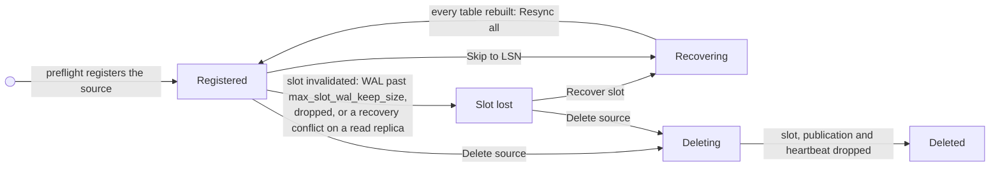
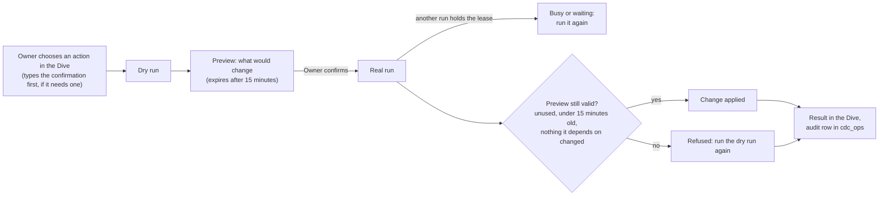

# Operations: the `cdc_ops` status database

Each Flight writes its status to a MotherDuck database, `cdc_ops` (`CDC_OPS_DATABASE`,
an owner setting), for the operations Dive. The Dive reads only this database, through
a share; it never reads `cdc_internal` or the stores.

**`cdc_ops` is lossy and eventually consistent.** A Flight writes it once per run,
after its own work, as best effort: a failed write is logged as its exception type
and never changes the run's result. Never act on it alone: the action Flights re-read
the authoritative stores.

## Tables

| Table | Written by | Rows | Content |
| --- | --- | --- | --- |
| `ingest_status` | ingest | one per source | the last leased run (status, failing step and exception type, epoch, the checkpoint it reached, counts), the last successful run, `slots` (JSON: the current slot and any pending `<slot>_e<n>`, with WAL status, retained and lag bytes, the restart gap and, past 1 GiB, the oldest open transaction's age), `holds` (JSON: the registry's held tables with reason, detail and first seen), the last busy and last failed runs, and `lifecycle` (`deleting_or_deleted`, when a failed run found the slot tombstoned by delete-source). Also (added in place, by `ADD COLUMN IF NOT EXISTS`, by the first report): the unit position (`format_version`, `confirmed_end`, `open_unit_anchor`, `partial`, `open_chunks`, `durable_frame_end` (a frame ordinal, not an LSN), `config_revision`), also on each `ingest_runs` row, and `last_conflict_*`: the last run that kept its durable progress but stopped on a compaction conflict (status `conflict`), and "current as of" (`durable_through_commit_ts` with its `durable_through_epoch`/`durable_through_lsn`; see [Current as of](#current-as-of)) |
| `ingest_runs` | ingest | one per run, 7 days | transactions, chunks, duration, retained and lag bytes, PostgreSQL TLS (`tls_mode`, `tls_ca`, `tls_in_use`; see below), `cleanup_release_attempts` (cleanup autocommit release attempts only), `epoch`, and `durable_through_commit_ts` (the commit time at this run's `confirmed_end`, NULL when unknown) |
| `apply_status` | apply | one per table | state, `held_since` (first seen), detail, blocked commit, applied checkpoint, generation, key version, registry hold, table pin, and `quarantines` (JSON: the current generation's quarantined commits, the newest 200 across the source, with an exact per-table `quarantine_count`; the operator's reason stays in the audit row) Also `format_version`, `blocked_unit_start_lsn` (the held unit; equals the applied checkpoint while held; `blocked_commit_lsn` still names the original commit), `blocked_unit_end_lsn` (that unit's end, from the complete unit; the Dive builds Quarantine's confirmation from both), each `quarantines` item's `unit_start_lsn`/`unit_end_lsn` (the whole unit it skipped), and "current as of" (`applied_through_commit_ts` with its `applied_through_epoch`/`applied_through_lsn`), and `hold_code` (see Hold codes). A registered table with no generation yet has a row too, with state `not_started`. |
| `apply_runs` | apply | one per table per run plus the run's own row (`table_name` NULL), 30 days | status, events, applied checkpoint; for the run's row, the exception type and step of a failed run. Also `format_version`, `units_applied` (whole units committed), `applied_through_commit_ts` (the commit time at the row's applied checkpoint; NULL when unknown and on the run's row). |
| `backfill_status` | backfill | one per generation, kept (one per backfill) | state, chunks done and estimated total, rows, scan done, catch-up and marker LSNs, timestamps |
| `backfill_runs` | backfill | one per run | table, generation, status, the exception type and step of a failed run, and PostgreSQL TLS. Also `format_version`, `units_applied`, and the run's catch-up batches by fold, `sql_batches`, `fallback_batches` and `redo_batches` (NULL before this build). |
| `compaction_status` | compaction | one per source | the last run (status, drops, prunes, kept reason, budget, expiry counts, limits in force), `pins` (JSON: every retention pin's held day, last advance, rule and estimated expiry, and how many runs in a row reported it superseded), `days` (JSON: every retained log day's status, events, bytes and LSN range), `expirations` (JSON: the last 30 days of released pins, with rule, outcome and floor) Also `format_version`, `chunks_pruned`, `units_pruned`; `batches_pruned`/`manifests_pruned` are always NULL (an earlier log format's). |
| `preflight_status` | preflight | one per source | status, exception type, warnings |
| `sources` | ingest | one per source | the owner-set `label` and `description` (NULL when unset or withheld), `label_revision`, `label_withheld` (why a set label isn't shown), and `owner_user` (the MotherDuck user of the token ingest ran with: the Flight owner). See [Source label](#source-label) |
| `audit` | action Flights | one per action | `token_user` (the Flight owner's token), `started_by` (who started the run, when the run could read it), run id, action, inputs, dry run, result, PostgreSQL TLS for the actions that connect to it, and `request_id` (the caller's `CDC_REQUEST_ID`, NULL when not given) |

JSON items carry a format version `v`; keys are only ever added.

**PostgreSQL TLS** ([flights.md](flights.md#postgresql-tls-verify-full)) is recorded in run
rows only (`ingest_runs`, `backfill_runs`, `audit`), never in a status row: a status row
is upserted with the columns the running build knows, so after a rollback it would keep
a newer build's value. The three columns:
- `tls_mode`: the sslmode the run's connections asked for (`verify-full`, `require`, …);
- `tls_ca`: the trust root's label (the `--pg-ca` name, such as `rds-global`; `system`,
  `dsn` or `default` for a DSN's own `verify-*` setting), NULL unless the mode verifies
  the server, and never a path;
- `tls_in_use`: whether every PostgreSQL connection the run opened negotiated TLS
  (`prefer` can fall back to plaintext silently), NULL if it opened none.

NULL means unknown: a build from before these columns, or (in `audit`) an action that
never connects to PostgreSQL. A source's current TLS state is its newest `ingest_runs`
row (it ages out with `ingest_runs`' 7 days, so a source with no ingest run in that time
shows none); never infer it from `audit`. Preflight has no run table: its mode is only in its
`postgres tls=` log line.

### Current as of

How current the data is, by the **source's clock**: the PostgreSQL commit timestamp of
the newest commit at or below a checkpoint. Exactly: the last commit of the complete
unit that ends at that checkpoint (units are contiguous, so one checkpoint has one
time). Heartbeat commits count, so an idle source still advances every ingest run.

- **Ingest:** `ingest_status.durable_through_commit_ts`, for the durable checkpoint
  `checkpoint_lsn` (always equal to `confirmed_end`). The run takes it from its
  own durable chunks in memory, so it costs no statement.
- **Apply:** `apply_status.applied_through_commit_ts`, for the table's `applied_lsn`. Apply
  takes it from the units its reads checked this run. A table that read nothing (apply's
  idle shortcut, already at the checkpoint) keeps its stored time, or on its first report
  matches an `ingest_runs` row with the same `epoch` and `confirmed_end`. A table with no
  events in a range still advances to the checkpoint, so its time tracks the heartbeat; a
  held table's time stops at the unit before the hold.
- **Each time is stored with the position it belongs to** (`*_through_epoch`,
  `*_through_lsn`). Read it only when that pair equals the row's own `(epoch,
  checkpoint_lsn)` or `(epoch, applied_lsn)`; otherwise it's unknown. An older build
  (a Flight not yet redeployed, a rollback) moves the checkpoint without touching these
  columns, and the pair check keeps its stale time from reading as current.
- **Exact or NULL**, never an older time. It's NULL (unknown) until the position next
  advances for a table held since before this build, for a table at a position this run's
  reads didn't cover and no ingest run ended at, and on the first apply report after a
  deploy when ingest's report for that checkpoint hasn't landed yet (the chain starts
  apply before ingest writes its report). Both folds see each unit's commits (the SQL
  fold's page plan, the Python fold's frame reads).
- **Caught up** is a position test: a table's `(epoch, applied_lsn)` equals the source's
  `(epoch, checkpoint_lsn)`. The two times are then equal too, but they're for display;
  don't decide on them.
- **Caught up means every logged change is applied, not that the mirror equals the
  source.** DDL that writes no logical changes for existing rows isn't in the log.
  Ingest's catalog checks hold most of it at the last verified cut:
  - ADD COLUMN with a DEFAULT (constant or volatile);
  - ATTACH or DETACH PARTITION;
  - a primary key replaced between two ingest runs.

  A source type change under the same mirror type holds at its first event. What stays
  unseen, a table reads caught up and still differs:
  - a same-type `ALTER COLUMN … TYPE … USING` rewrite;
  - a leaf detached and re-attached between runs;
  - an append table's new-column fill.

  After such DDL, resync the table; see the DDL matrix in
  [tables.md](tables.md#source-ddl).
- **Before deploying the release with source-type checks,** run `cdc-flight-tables types`
  (read-only). For each table it lists as `holds`, either resync it or, when its retype
  changed no value, run `cdc-flight-tables accept-types --table T --dry-run`, then the same
  with `--confirm` set to the text the dry run printed.
- **A `catalog check` warning** in an ingest run's log means a table's file was rewritten
  (VACUUM FULL, CLUSTER, TRUNCATE or a same-type rewrite). It holds nothing. Resync if
  that rewrite changed values (a same-type `USING`).
- **Each table is caught up on its own.** A source transaction that wrote two tables can
  be visible in one mirror before the other, so a join across two mirror tables may see
  them at different positions. There's no cross-table atomicity.
- The source's clock, not MotherDuck's: lag is `now()` minus the time only as far as the
  two clocks agree.

### Source label

An owner-set display name for a source (`orders-prod`), with an optional description or
contact (`RDS us-east-1, data-platform`), so the Dive can say which database a source is
without showing connection details.

- **Set it with the owner's token:** `cdc-flight-label set --label NAME [--description
  TEXT]` (`show` prints the current one), with `CDC_SOURCE_ID` and `CDC_DATABASE` set. It
  appends a revision to `<change-log database>.main.source_label`; history is kept. No
  Flight reads a label from config, so a RUN grantee can't set one, and a rename needs
  no rebuild or redeploy.
- **Rules:** a label is 1–40 letters, digits, spaces, `.`, `_` or `-`; a description is at
  most 120 printable characters without `@ : / = ? # \ " '`. Either is refused if it looks
  like connection details: an IPv4 address, a dotted host name, `amazonaws`, `rds.`,
  `localhost`, or the words `password`, `sslmode`, `dbname`, `user` or `host`.
- **Ingest publishes it** to `sources` on its next run: one read, plus a write only when
  the published row differs (a relabel, or an edit made in `cdc_ops`). If the label or
  description matches the connection ingest just opened, as libpq resolved it (the
  password or any listed host, anywhere in the text, including a host's DNS labels of 4
  or more characters; the user or database name of 4 or more characters, as whole
  words), it publishes `label` NULL with `label_withheld = 'matches source connection'`.
  If it can't read those values, `'connection values unreadable'`. The value stays only
  in the change-log database. A failed read or write keeps the published row and never
  changes the run's result.
- **Unset or withheld,** the Dive shows `source_id`. A source whose change log has no
  label row is published with `label` NULL.
- **It never names a database.** `set` prints `mirror_suggestion_for_setup`
  (`<slug>_mirror`), for the owner to accept as `CDC_MIRROR_DATABASE` when setting up a
  new source. Nothing applies it, and after setup a relabel leaves the mirror alone:
  apply, compaction, expiry, backfill and the action Flights' `OWNER` all name the mirror,
  so renaming it is a migration of its own.

`error` is always an exception **type**. `SystemExit` means the run refused or stopped
on purpose (bad config, a held table, a stalled backfill): see the run's own log line
for which. Anything else is an unexpected failure.

## How the rows stay truthful

- **One writer per table**, and each write touches only its source's rows.
- **Newer wins.** Each part of a row carries the server time its data was read
  (`*_as_of`, epoch microseconds) and is replaced only by a newer read. A part a run
  didn't read keeps its value, so a late report from an older run, or a run that
  failed early, never blanks or rewinds it.
- **Busy runs** write only `last_busy_*`; **failures before a lease** only
  `last_failure_*`. A run that failed before reading its slot reads it once more on
  a fresh connection, so a lost or missing slot shows as it is.
- **Snapshots** (apply, backfill, the registry's holds) are read inside the write
  itself, so they are as fresh as the write.
- **Staleness is visible:** every row has `written_at` (server time) and a run id.
- **No user data:** no row values, payloads, keys, hosts, users or DSNs.

A guarded compaction conflict ends the ingest
run as busy if it collected no new progress, or conflict if it kept a durable
complete-unit boundary. The result reports only that run's collected boundary;
a later run resumes there. Lease release tries the statement up to four times
(three retries), with about 1.3 seconds of total backoff. If compaction still owns the
guard, the run fails and the lease expires (up to 900 seconds by default, about
five skipped runs on the default `*/3` schedule, or at most one hourly run depending on
timing).
The next run then continues. Retried releases log
the attempt count and error type. Repeated conflicts or exhausted retries warrant
checking overlapping schedules; this retry window has not been measured in-region.

`ingest_runs.cleanup_release_attempts` records how many autocommit statements the
cleanup release issued, including an attempt that failed for a non-conflict reason.
It is not a retry count and excludes the transactional release inside `finish`:
`0` means cleanup found the token already released; `1`–`4` count cleanup attempts.
`NULL` means this invocation did not reach cleanup release (or the writer predates
this field), including a pre-acquisition refusal or cleanup interrupted before that
step. The value is reset per invocation, including when a client reuses its log.

This is history-only, best-effort telemetry. Busy runs do not write history, even
when a no-progress conflict performed cleanup, so their counts are not persisted.
An older ops database gains one nullable history column on the next ingest report;
existing rows remain NULL. Once the column exists, reporting adds no SQL statements.

## Hold codes

`apply_status.hold_code` says why a table is held, as a stable code. The Dive matches on it,
not on `detail`'s wording. The set is closed: `cdc_flight/hold_codes.py`, `HOLD_CODES`.
The states these codes belong to, and what moves a table between them, are in
[tables.md](tables.md#table-states).

**Reading it:**
- **non-NULL:** the current reason;
- **NULL while `state` is `live`:** not held;
- **NULL while `state` is held:** unknown. An older build set the state, or changed it last. Read `detail`.

A code is written only together with the state it explains. Apply's snapshot reports it only when the same
mirror statement set both, so a later state change by an older build never shows a stale code.

**Precedence:**
1. A registry hold (the log's `held_reason`) wins: the table isn't being ingested.
2. Otherwise, a not-started row's `not_started`.
3. Otherwise, the mirror's code.

| code | state | meaning; next step |
|---|---|---|
| `append_update`, `append_delete` | needs_action | an UPDATE or DELETE on an insert-only table; resync, quarantine its unit, start-from-log, or remove it |
| `append_keyed_frames` | needs_action | an insert-only table's frames carry a key; remove the table and add it again |
| `type_changed` | needs_action | a column's source type changed under the same mirror type; `tables accept-types` (a benign widening) or resync |
| `schema_changed` | needs_action | a column was dropped, renamed or retyped in the mirror, the replica identity is missing, NOTHING or differs, a reserved prefix, or duplicate names; repair the mirror and retry, or resync |
| `source_mismatch` | needs_action | the reader refused the stored binding or protocol |
| `poison` | needs_action | one unit's data error; quarantine the unit, or repair and retry |
| `missing_baseline` | needs_action | an update of a row absent from the mirror without a full image; repair and retry, or resync |
| `incomplete_insert` | needs_action | an insert without a complete new image |
| `unsupported_change` | needs_action | a change kind apply doesn't support |
| `key_cell` | needs_action | a replica identity cell isn't a value |
| `key_change_ambiguous` | needs_action | a key change with unchanged columns and no full old image |
| `pin_invariant` | needs_action | completing the table's retention pin transfer found the registry inconsistent (an InvariantViolation, rolled back): inspect `_cdc.tables` and `retention_pins` for the table, repair, then retry; the other tables keep applying |
| `key_changed` | needs_resync | the source's replica identity key changed |
| `epoch_changed` | needs_resync | the source epoch changed |
| `history_lost` | needs_resync | the retention pin is missing or the history was dropped |
| `retention_expired` | needs_resync | the table's pin expired (compaction) |
| `truncate` | needs_resync | a TRUNCATE in the table's history |
| `pk_replaced`, `partitions_changed`, `column_default_fill`, `column_rewrite` | needs_resync (keyed); `partitions_changed` is needs_action for append | a catalog check ([tables.md](tables.md#source-ddl)); resync, or start-from-log for append |
| `paused` | paused | an operator paused the table |
| `not_started` | not_started | registered, with no generation and none running (a running one shows in `backfill_status`); start it, or see `backfill_runs` for a refused first backfill |
| `dropped`, `renamed`, `replaced`, `unpublished`, `unmanaged`, `removed`, `invalid_kind`, `no_select`, `no_key`, `identity_not_full`, `leaf_invalid`, `publication_filter`, `append_identity`, `append_partitioned` | the registry's | the log's `held_reason`, verbatim (preflight's table checks and membership) |

**Stale rows.** `apply_status` is upserted, never deleted. A row whose `as_of` is older than the newest full
snapshot's `as_of` for the source wasn't rewritten by it, so its table is no longer reported. The newest full
snapshot is the rows written by the latest `apply_runs` run row's `run_id`. For example, a table removed after
it was `not_started` keeps its last row; readers hide stale rows.

## Backfill catch-up

Each backfill run prints its result line with `fold`, the catch-up batches it ran by
path: `sql` (folded on MotherDuck, no frames read into the Flight) and
`fallback:<reason>` (the Python fold: `truncate`, `layouts`, `key_layout`,
`key_change`, `reconcile`, or a blocking event's reason). `sql` and `fallback:*`
add up to the batches. `redo:<error>` counts SQL batches whose MERGE refused a data
error (or its baseline check) and that were redone once on the Python fold, reading
their frames into the Flight. `backfill_runs` keeps the totals as `sql_batches`,
`fallback_batches` and `redo_batches`. A resync that should have run on SQL
but shows only fallbacks has pages the SQL fold can't take, for example several
schema versions in one page.

**A catch-up page ran out of memory on MotherDuck.** The generation fails with
`OutOfMemoryException in catch-up (SQL fold) units <start>..<end>`. It is not retried,
because the same page would fail again: a unit is never split, and the page holds at
least one whole unit. Next steps, either one:
- run the backfill (resync) again on a larger MotherDuck instance;
- run it when the source's write load is lower, so the catch-up range holds smaller
  units.

## Cost

One attach plus one or two statements per run: apply and backfill write 3
MotherDuck statements once the tables exist (4 on a run that prunes history, which only runs starting
00:00–01:00 UTC do), compaction and preflight 2. Ingest writes 4: the same 3 plus the source
label's read, and a fifth (its write) only on a run where the published label changes.
The label read added 16 ms per run (median of 30, from an AWS host to MotherDuck), and
the write 18 ms more. The write is skipped when less than 15 s of
the run's budget remains, and interrupted after 5 s. A fresh database adds ten
`CREATE TABLE IF NOT EXISTS` statements on the first report; these share that
watchdog rather than receiving extra time.

## Deploying

Create the database once, as the Flights' owner (`CREATE DATABASE cdc_ops`, or the
name in `CDC_OPS_DATABASE`). The first status report, including preflight, creates
all ten missing tables from the shared writer DDL before inserting its own status.
The Dive can bind every query before the first compaction, apply or backfill.
This bootstrap inserts no rows into the other writers' tables and does not alter
existing unrelated tables; each writer retains its own additive column healing. A run never
creates the database itself: until it exists, each run skips its status write
(`skipped:no_database`). Schema creation shares the report's five-second watchdog
and remaining-budget check; it is best effort, so successful source registration
does not guarantee that the ops schema is ready. A later report retries missing
tables. Dive deployment also initializes the schema before its column precheck.
Then create a share of `cdc_ops` and share it with the Dive's
viewers. Freshness is about a minute; the action Flights run `CREATE SNAPSHOT` after
each run. The operations Dive over this share is in [dive.md](dive.md); the runbooks it
supports are in [runbooks.md](runbooks.md).

## Read replica sources

A source captured from a **read replica (standby)** has its own diagnostics (`ingest_status.standby`,
advisory only), runbooks (`waiting_for_primary`, a slot invalidated by a recovery conflict,
failover, a stopped heartbeat job, delete-source's cleanup on the primary) and requirements (the
backfill Flight must be a package Flight): see [read-replica.md](read-replica.md).

## Source lifecycle



| State | What the Dive shows on the source | What to do |
| --- | --- | --- |
| Registered | Healthy, or Warning, Needs action, In progress or Not enabled, from its tables and its sync | Normal operation. |
| Slot lost | Needs action: "Replication slot invalidated" | Run Recover slot ([The epoch Flight](#the-epoch-flight), [runbooks.md](runbooks.md) R1). |
| Recovering | Recovering; its tables show Queued, then Rebuilding | Run Resync all, and Resync each insert-only table. Each table's mirror stays queryable at its old data until its rebuild publishes. |
| Deleting | Needs action: "Source being deleted · N tables" ("Source deleting or deleted" when the Dive can't tell which) | Run Delete source again. It finishes what's left. |
| Deleted | Needs action: "Source deleted · N tables" ("Source deleting or deleted" when the Dive can't tell which) | Nothing. The source id is final: to capture the database again, register it under a new id. The mirrors and the change log are kept. |

**Recover slot** starts a new *epoch*: a new slot (`<slot>_e<n>`), from the source's current
position. Changes made between the old slot's last confirmed position and the new slot can't be
read, so every table needs a resync ([Table states](tables.md#table-states)). Its typed
confirmation is `RECOVER <source> EPOCH <n>`.

**Skip to LSN** moves the slot past a range of WAL that can't be read. It also starts a new epoch.

**Delete source** drops only the objects this system created: the slot, the publication and the
heartbeat. Anything the DBA created is printed as DDL for the DBA to run. Its typed confirmation is
`DELETE <source>`.

## Action Flights

Action Flights let the Flights' owner operate a source from the Dive: pause, resume or
retry a table, resync one or all, compact now, add or remove a table, quarantine a
poison transaction, recover a lost slot or skip to an LSN, and delete a source. **Only
the owner may run them:** they have no RUN grants, and the Dive is read-only for every
other viewer ([dive.md](dive.md#actions)). The guards stop mis-clicks, stale screens and
wrong targets, not an owner who means the action. The authoritative record is in the database each action
changes.

### The table-action Flight

One per source, built with the owner's settings baked in:

```sh
uv run python scripts/build_flight.py table-action out/table_action.py --package <SHA> \
  --source <source_id> --backfill-flight <uuid> --compact-flight <uuid> \
  [--database cdc_internal] [--mirror <source_id>_mirror] [--ops-database cdc_ops]
```

| `CDC_ACTION` | Inputs (every other input must be blank) | Effect |
| --- | --- | --- |
| `pause` | `CDC_TABLE`, `CDC_EXPECTED_STATE` | `live` → `paused`: apply skips it, and its pin stays (retention may expire it) |
| `resume` | `CDC_TABLE`, `CDC_EXPECTED_STATE` | `paused` → `live`; a `needs_resync` table is refused with "resync" |
| `retry` | `CDC_TABLE`, `CDC_EXPECTED_BLOCKED_LSN` (`X/Y`, or `none` for a hold with no blocked commit) | `needs_action` → `live`, after a repair |
| `resync` | `CDC_TABLE`, `CDC_EXPECTED_STATE` | Starts the backfill Flight for the table. Allowed from `needs_resync`, `needs_action`, `paused` and `live` (a full reload; from `paused` it ends the pause); refused while a backfill runs or the source table is held. For an append table it is an exact re-snapshot (below): the current mirror is kept aside as `<table>__gen_<generation>`, refused while an older kept-aside table exists (the refusal gives its `DROP TABLE`) and for a paused table. Under `ignore_deletes` the preview says that rows the source has purged leave the mirror and remain only in the kept table |
| `start-from-log` | `CDC_TABLE` | An append (insert-only) table's first mirror generation, from the log at the current durable position S (any epoch). Rows already in the table are **not** copied: the dry run says so, and the confirmed preview accepts it. The result reports the epoch and S. It replaces a generation that can't apply: held, keyed (the table was added again in append mode), or with its pins released (removed and added again). The old mirror table is renamed to `<table>__gen_<generation>` and its rows are kept. A healthy live generation is never replaced (`already`). Refused for a keyed table (resync instead) and while the source table is held |
| `start-snapshot` | `CDC_TABLE` | A registered table's **first** snapshot (keyed or append; it has no mirror generation yet): starts the backfill Flight with that table and start, as a backfill run does. `already` when the table has a generation (resync instead). Refused while a backfill runs, when the source table is held, and for an append table while the backfill Flight predates append snapshots. The backfill run's own refusals (such as an append table over `CDC_APPEND_SNAPSHOT_MAX_BYTES`: start-from-log, or raise the limit) are in its `backfill_runs.detail` |
| `accept-types` | `CDC_TABLE`; the real run also `CDC_CONFIRM` | For a table held `needs_action` on a source type change under the same mirror type (hold code `type_changed`): rewrites the changed columns' stored source type (OID, typmod) to the blocked commit's own schema version, so the next `retry` reconciles. The dry run lists the columns and returns `confirm`, the exact `ACCEPT TYPES <schema.table> <digest>` (the digest names the change, its schema version and the blocked unit); the real run needs it. Accept only if every existing value was kept: a value-changing `USING` rewrite needs a resync. The table stays `needs_action` until `retry` |
| `resync-all` | none | Starts **one** backfill, for the `needs_resync` table held longest that has no backfill running, and reports `remaining`. Run it again for the next |
| `compact-now` | none | Starts the compaction Flight with the owner's settings |

Each run prints one JSON line: `status` (`done`, `already`, `would`, `refused`,
`busy` or `failed`), `action`, `table`, `detail`, `next_steps`, `observed`, `run_id`,
and `preview_id` (a dry run), `triggered` (a started Flight) or `remaining`
(resync-all). Exit codes: 0 for done, already and would; 2 refused; 3 busy; 1 failed.
`cdc-flight-tables pause|resume|retry` runs the same library functions, so the CLI and
the Flight give the same answer for the same state.

### The quarantine Flight

`cdc-<src>-quarantine` is the repair action: a held table is held before one whole unit, and
quarantine skips that **whole unit** for the table's generation. It runs the library's
quarantine (`cdc-flight-tables quarantine`) as a Flight.

```sh
uv run python scripts/build_flight.py quarantine out/quarantine.py --package <SHA> \
  --source <source_id> \
  [--database cdc_internal] [--mirror <source_id>_mirror] [--ops-database cdc_ops]
```

- **Inputs:**
  - `CDC_TABLE`;
  - `CDC_EXPECTED_EPOCH`;
  - `CDC_CONFIRM`, which must be exactly `QUARANTINE <schema.table> UNIT <epoch> <X/Y>..<X/Y>`,
    the unit's start and end in PostgreSQL's uppercase form, as the dry run prints it;
  - the usual `CDC_DRY_RUN` and `CDC_PREVIEW_ID`.

  A refused dry run prints the literal to type.
- **Only a poison unit can be quarantined.** Any other hold is refused with its way out:
  retry after a repair, or resync.
- **The dry run** shows the unit's first and last original commits and its commit and event
  counts. The preview also covers the unit's identity (its bounds, member count and digest),
  the generation, the epoch and the configuration revision. If any of them changes, the
  real run is refused: run a new dry run.
- **The real run** spends the preview in the same mirror transaction as the quarantine row
  (its own audit) and the return to `live`.
- **It has no secret and no free-text input.** The quarantine row's reason is generated,
  never typed by an operator. Any future reason input must be labelled **"no row data"**,
  because audit rows are visible to the whole org.
- **The rows the unit touched may diverge until a resync,** so the result's next step is
  `resync <table>` on the table-action Flight.
- Retry (table-action) likewise replays the whole blocked unit.

### The epoch Flight

`cdc-<src>-epoch` is the destructive way past a gap in the change log. It's
`cdc-flight new-epoch` as a Flight.

```sh
uv run python scripts/build_flight.py epoch out/epoch.py --package <SHA> --source <source_id> \
  [--slot …] [--publication …] [--heartbeat …] [--dsn-env CDC_PG_DSN] \
  [--database cdc_internal] [--ops-database cdc_ops]
```

| `CDC_ACTION` | Inputs | Confirmation (exact) | Effect |
| --- | --- | --- | --- |
| `recover-slot` | `CDC_EXPECTED_EPOCH` | `RECOVER <source_id> EPOCH <n+1>` | The slot is lost, missing, or ahead of the durable checkpoint. Creates `<slot>_e<n+1>` and begins epoch n+1 at its consistent point. WAL the old slot lost is gone |
| `skip-to-lsn` | `CDC_EXPECTED_EPOCH`, `CDC_TO_LSN` | `SKIP <source_id> TO <X/Y>` | Advances the slot to the target and begins epoch n+1. `[checkpoint, target)` is never ingested, and the result states its size |

Either way, **every mirror then needs a resync**: run `resync-all` on the table-action
Flight, once per table, until none remain. Nothing here starts another Flight.

- **The dry run** is read only: no lease and no PostgreSQL change. It reports what would
  happen and records the preview in `cdc_internal`'s `<source_id>.previews`.
  - A refused dry run prints the literal to type.
  - The preview covers the epoch, the slot and the checkpoint, the slot's state, and the
    target. A run of ingest in between changes the checkpoint, so the next click needs a
    new dry run.
- **The real run:**
  1. waits up to 2 minutes for the ingest lease;
  2. re-reads, read only;
  3. **spends the preview first**, in its own guarded transaction, because the next step
     changes PostgreSQL slots;
  4. creates or advances the slot;
  5. records the epoch, including who started the run.

  **A spent preview stays spent even if the transition then stops,** so a re-click needs a
  new dry run. The transition itself is idempotent: a repeat reports `already`.
- **`waiting`, exit 0:** ingest held the lease past the wait, a reader is attached to the
  slot, or a bounded PostgreSQL wait ran out. Set `max_runtime_sec` to 600.
  - **Slot creation** waits for every running source transaction, for up to 4 minutes. If
    the wait runs out, nothing changed, and the cancelled creation leaves no slot behind.
  - **A skip advances the slot in steps** (32 MB each), and every finished step's progress is
    kept.
    - A step that's cancelled loses only its own progress.
    - When the run's budget (about 7 minutes) is spent, it reports how far it got. A new dry
      run, which shows the remaining bytes, and a click continue from there.
- **Repeating a click that already succeeded** (the same epoch and literal) reports
  `already` and needs no new preview. It also finishes the old slot's cleanup.
- **A slot this run created never stays to hold WAL by accident.**
  - If the run gives up before the epoch is recorded, it drops the slot, but only after
    re-reading that the epoch really wasn't recorded.
  - If it can't tell (MotherDuck unreachable), it keeps the slot and names it. The next run
    finishes or reuses it.
- **The old slot is dropped only after the new epoch is recorded,** and that drop is best
  effort.
  - If a reader is attached, the result reports `leftover_slot` with its retained WAL.
    Repeating the same click reports `already` and drops it.
  - Only an inactive `pgoutput` slot of this database is dropped. A same-named slot another
    tool created is left alone and reported.
  - Until then, ingest's status lists it with the role `leftover`.
- **The secret:** this Flight needs a role that can create, advance and drop replication
  slots (`REPLICATION`). `--dsn-env` bakes only the variable's name.
- **Before deploying,** update every Flight of the source from the same commit: this
  Flight adds a column to `source_epochs`.

- **Whole units:** a new epoch abandons the **whole** open
  unit, never part of it.
  - The result and its audit row record the abandoned unit: its start, the frames and
    chunks written, its first, last and active original commits, and the epoch it was
    abandoned into.
  - **A skip only moves forward,** past the last complete unit and the open unit's durable
    members: the target must be beyond the checkpoint, beyond an active member's commit,
    and at or after the last member's end. Otherwise it's refused, and the refusal says
    why. There's no rewind.
  - **A target beyond the source's current WAL is clamped to it.** It skips all the WAL
    that exists, never more; later changes are ingested by the new epoch. The result says
    `clamped: true`, with the `requested_to_lsn` beside the actual `start_lsn`. The anchor is
    the source's WAL at the click, which can be later than at the dry run, but never past
    the typed target.
  - The preview also covers the unit position, the durable prefix included. If ingest adds
    to the open unit between the dry run and the click, run a new dry run.

### The delete-source Flight

`cdc-<src>-delete-source` stops capturing a source for good. The mirrors, the change log and
the registry are kept. A deleted source id is final: register the source again under a new id.

```sh
uv run python scripts/build_flight.py delete-source out/delete_source.py --package <SHA> \
  --source <source_id> [--slot …] [--publication …] [--heartbeat …] [--dsn-env CDC_PG_DSN] \
  [--database cdc_internal] [--ops-database cdc_ops]
```

- **Inputs:** `CDC_EXPECTED_EPOCH`, and `CDC_CONFIRM` = `DELETE <source_id>`, exactly. Both
  are required on every run, including the one that finishes a delete.
- **The dry run** is read only. It lists what would be dropped and the DDL left for the DBA.
- **The real run** spends the preview in the transaction that marks the source `deleting`.
  It then drops what this code created, and marks the source `deleted`.
- **Only what this code created is dropped:**
  - the slot, publication and heartbeat that preflight created (`create_objects`), or a
    recover's new slot;
  - any pending `<slot>_e<n>` slot an interrupted recover left behind: exactly that name,
    `pgoutput`, in the source's database, with no reader attached.

  A source registered before this version drops nothing; the result prints the DDL for the
  DBA. So do objects this role can't drop (no `REPLICATION`, which on RDS is membership in
  `rds_replication`; or it doesn't own the publication or the heartbeat), and a slot an
  earlier recover replaced but couldn't drop.
  The dry run finds those first, and `retained_bytes` sums the WAL that this source's slots
  still hold.
- **From the first step, every Flight of the source refuses it,** older builds included. The
  source's slot name is replaced by `deleted:<source_id>`, which older builds reject before
  they connect to PostgreSQL.
- **`waiting`** means an ingest reader is still attached to the slot (it's refused from then
  on), or ingest held the lease past the wait. The source stays `deleting`, and running the
  Flight again finishes it, with no new preview.
- **The secret:** a role with `REPLICATION` that owns the publication and the heartbeat. Use
  `max_runtime_sec` 600. Afterwards, remove the source's crons and grants.

- **The change log is kept:** the drop list is unchanged, PostgreSQL
  objects only; the change log and every mirror are kept. The preview also covers the
  source's unit position, so a unit completing or opening in between needs a new dry run.

### The table-membership Flight

Adding and removing a table is its own Flight, `cdc-<src>-table-membership`, because
it needs the source's PostgreSQL secret (as the epoch and delete-source Flights do). The
table-action and quarantine Flights never hold it.

```sh
uv run python scripts/build_flight.py table-membership out/table_membership.py --package <SHA> \
  --source <source_id> --backfill-flight <uuid> \
  [--slot …] [--publication …] [--heartbeat …] [--dsn-env CDC_PG_DSN] \
  [--database cdc_internal] [--mirror <source_id>_mirror] [--ops-database cdc_ops]
```

| `CDC_ACTION` | Inputs (every other input must be blank) | Effect |
| --- | --- | --- |
| `add` | `CDC_TABLE` | Registers a table that's in the publication (or adopts, re-activates or relabels it; see `cdc-flight-tables add`), then starts its backfill. A relabel keeps its mirror and starts nothing. It never alters the publication |
| `add`, append mode | `CDC_TABLE`, `CDC_MODE=append`; `CDC_IGNORE_DELETES=1` optional | Registers a keyless table for insert-only capture (below), then starts its exact snapshot backfill, when the backfill Flight runs a release that takes one. Otherwise, or for a table over the size limit, the next step is the table action `start-from-log` |
| `remove` | `CDC_TABLE`; `CDC_FORCE=1` and `CDC_CONFIRM=REMOVE <table>` for a table that still exists | Stops capturing the table and releases its pins. The mirror table is kept |

Append mode (`CDC_MODE=append`, CLI `--mode append [--ignore-deletes]`) is for a table
with no primary key or replica identity index. Its checks, in the order the owner fixes
them:
1. The table has a key → add it keyed instead. The key is read from PostgreSQL.
2. It has a unique index that PostgreSQL accepts as a replica identity: unique, valid, not
   deferrable, not partial, plain columns only, every column `NOT NULL`. Then capture it
   keyed instead. The refusal gives `ALTER TABLE … REPLICA IDENTITY USING INDEX …`, smallest
   index first.
3. It's partitioned (refused), unreadable, or its identity isn't `FULL`. Run
   `ALTER TABLE … REPLICA IDENTITY FULL` **before** `ALTER PUBLICATION … ADD TABLE`. A keyless
   table published without FULL makes its own UPDATE and DELETE fail on the source.
4. It isn't in the publication.
5. It's registered and captured or held. Only an unmanaged row (published, seen by ingest),
   a removed row or no row qualifies.
6. **Version stamps.** Every Flight that runs a keyed path (apply, backfill,
   table-action, table-membership, quarantine) must run this release or a later one.
   Each records it on every run in its Flight. A command this source has no Flight for is
   declared once: `cdc-flight-tables releases --not-deployed <command>`. A later Flight
   run of that command replaces the declaration. `cdc-flight-tables releases` lists each
   command as stamped, not deployed or missing. A Flight created later from a release
   older than the guard isn't detected, the same as any rollback to one.

What an append table does:
- Every INSERT becomes one mirror row, and duplicate rows stay duplicates. The mirror has
  no primary key. `_cdc_commit_lsn` and `_cdc_event_ordinal` name each row.
- An UPDATE holds the table `needs_action` before its whole unit (`append_update`).
  So does a DELETE (`append_delete`), unless the table was added with
  `CDC_IGNORE_DELETES=1`. Then DELETEs are skipped and counted in `cdc_ops.apply_status`
  as `deletes_ignored`, and the mirror means "every row inserted".
- To clear such a hold, resync it: an exact re-snapshot (below), which holds again if
  the table keeps changing rows. Or quarantine the unit (a recorded gap until a resync:
  the unit's inserts go with it), or run `start-from-log` again (a new generation at the
  current position). The old mirror is kept under another name, at most one per table.
- A TRUNCATE empties the mirror in place, under `ignore_deletes` too. Only the rows
  inserted after it remain. `last_truncate_lsn` shows the last one.
- ADD COLUMN works, with earlier rows NULL. A drop, rename or type change holds, as for a
  keyed table.
- A key that appears later changes nothing: the table stays insert-only. To capture it
  keyed, remove it and add it keyed.
- Identity changed away from `FULL` holds the source table (`append_identity`) until it
  is `FULL` again. That clear needs no resync, because every insert carried every column.

**The exact snapshot backfill.** A keyless table has no key to chunk
by, so its backfill reads **one** PostgreSQL snapshot in **one** run:
- It creates a temporary logical replication slot with an exported snapshot. The
  snapshot holds every transaction that committed before the slot's consistent point C;
  catch-up appends the table's logged changes from C on. Nothing is read twice and
  nothing is missed. The slot's connection closes as soon as the snapshot is imported,
  which drops the slot.
- **Size limit:** `CDC_APPEND_SNAPSHOT_MAX_BYTES` (backfill Flight config), compared with
  `pg_table_size` (heap and TOAST). The default, **1 GiB, is provisional** until the copy
  rate is measured. A larger table is refused with "use start-from-log, or raise the
  limit". A run that can't finish the copy fails the generation, and the next attempt
  starts over.
- **What the source owner provides:**
  - the backfill Flight's role needs replication capability (as ingest's does; on RDS,
    the `rds_replication` role), since it creates the slot;
  - one free replication slot and one free walsender while the copy starts;
  - a direct connection, or a session-mode pooler: transaction-mode PgBouncer breaks
    `SET TRANSACTION SNAPSHOT` and drops the connection's settings;
  - `old_snapshot_threshold = -1` on PostgreSQL 13–16 (the default).
- **What it costs the source:**
  - The copy's transaction holds the database's xmin horizon for the whole copy, so
    VACUUM can't remove dead rows anywhere in that database meanwhile.
  - A TRUNCATE of the table waits behind the copy (it needs ACCESS EXCLUSIVE), and later
    queries on the table queue behind it. Schedule the backfill away from truncates, or
    give the source's TRUNCATE a `lock_timeout`.
  - Creating the slot waits for transactions already running. After 300 s the
    generation fails; `pg_stat_activity` and `pg_prepared_xacts` show what held it.
- Snapshot rows have a NULL `_cdc_commit_lsn` and `_cdc_updated_at`, and their row
  number as `_cdc_event_ordinal`. `cdc_ops.backfill_status` shows L (`pin_lsn`), C
  (`snapshot_lsn`) and H (`marker_lsn`); a refused run's reason is in
  `cdc_ops.backfill_runs.detail`.
- An UPDATE, or a DELETE without `ignore_deletes`, after C fails the generation, as do a
  schema change apply would hold on, a catalog hold recorded during the backfill, and a
  held source table. A catalog change that ingest only detects after the backfill's end
  marker passes it: apply then holds the new mirror at once, and a resync clears it.
- The add starts the snapshot only when the backfill Flight's release stamp says it can
  take one; with an older backfill Flight the next step stays `start-from-log`.

`CDC_IGNORE_DELETES=1` is only for append mode. Preflight's `no_key` message gives the same
advice: the unique-index statement first, otherwise the FULL statement.

- **The secret.** `--dsn-env` bakes the *name* of the variable that holds the DSN,
  never the DSN itself. Attach that secret to this Flight only.
  - Only `add` reads PostgreSQL, through the catalog: is the table there, valid and in
    the publication? `remove` never connects.
  - **One role by default:** the same secret as preflight, ingest and backfill (pass
    their variable to `--dsn-env`; with no flag it is `CDC_PG_DSN`, ingest's default
    too). `add` checks that the role it connects as can `SELECT` the new table, so grant
    the replication role `SELECT` on a table before adding it: the same grant backfill
    needs to read it. With one role, a passing `add` also proves backfill can read the
    table. This is safe because, like every action Flight, only its owner runs it (no
    `RUN` grants).
  - **Optional hardening, two roles:** give this Flight a read-only role's secret instead
    (`SELECT` on the tables it may add, nothing else, never the replication role), so a
    leaked membership secret can't open a replication stream. It costs one more role
    and one more MotherDuck secret, and `add`'s check then tests the read-only role, not
    the one backfill reads with: grant `SELECT` on the new table to both roles.
- **A forced remove needs the typed confirmation** `REMOVE <schema.table>`, matched
  exactly. It stops capturing a live table, and only a re-add plus a full backfill
  undoes it.
- **It waits for the ingest lease.** Add and remove run under the ingest lease, which a
  scheduled ingest run holds for most of its runtime. A real run waits up to 2 minutes
  for it, then reports `busy` without spending its preview. Set this Flight's
  `max_runtime_sec` well above that wait plus the action (300, for example), so the
  runtime never cuts the wait short.
- **Previews live in `cdc_internal`** (`<source_id>.previews`), the database these
  actions change. This Flight creates the table on first use, and never creates the
  source's schema: before preflight, it refuses.
- **Before any write**, a real run checks its preview read-only. A stale click therefore
  changes nothing, not even the apply fence or a relabel's mirror rename. It then spends
  the preview in the same transaction as the registry change.
- **If the backfill doesn't start after an add,** the run reports `failed`. The table
  *is* added, so the next step is `resync` (table-action), not another add.

- **Unit boundaries:** a change takes effect only at a
  complete-unit boundary.
  - While an open unit holds durable frames, `add` and `remove` report `busy` (result
    `drain_required`, exit 3) and change nothing: no preview is recorded on a dry run, and
    none is spent on a real one. Let ingest drain the unit, then run a new dry run.
  - The preview also covers the source's unit position: a unit completing in between
    needs a new dry run.

### Config is input, and owner settings aren't config

`MD_RUN_FLIGHT` and the Dive can override any key a Flight declares. So an action Flight
declares **only its action's inputs**, each with a `""` default, which means unset:
- table-action: `CDC_ACTION`, `CDC_TABLE`, `CDC_EXPECTED_STATE`,
  `CDC_EXPECTED_BLOCKED_LSN`, `CDC_DRY_RUN` and `CDC_PREVIEW_ID`;
- table-membership: `CDC_ACTION`, `CDC_TABLE`, `CDC_FORCE`, `CDC_CONFIRM`, `CDC_MODE`,
  `CDC_IGNORE_DELETES`, `CDC_DRY_RUN` and `CDC_PREVIEW_ID`. A table-membership Flight
  deployed before `CDC_MODE` existed lacks those two keys, and `deploy_dive.py` reports it
  as an older build until it is redeployed;
- every action Flight (table-action, table-membership, quarantine, epoch,
  delete-source) also declares the optional `CDC_REQUEST_ID` (see [Audit](#audit)).

- **The owner's settings are in the stub,** as the `OWNER` literal, never in config:
  - the source and its databases;
  - the operations database;
  - the backfill and compaction Flights it may start.

  No run can name another database, table list, threshold or Flight.
- **Every input is checked before any connection.**
  - A table is `schema.table` and must be registered. It's matched by name and bound
    as a parameter, never interpolated.
  - States, LSNs, flags and ids each have a fixed format.
  - A key the action doesn't use must be blank.
  - A refusal names the key, never the value.
- **Config is visible to the whole org.** Put nothing secret in it; table names and
  LSNs are fine.
- **A started Flight gets config this Flight builds:**
  - for a resync: exactly `CDC_BACKFILL_TABLE` (the registered name) and
    `CDC_BACKFILL_START=1`;
  - for compact-now: nothing.

  The backfill and compaction Flights' own owner settings stay in force; their
  compaction thresholds are never passed through.

### How an action runs



**Destructive actions need a typed confirmation**, compared exactly: Quarantine, Recover slot, Skip
to LSN, Delete source, and a forced Remove table.

**A run is refused if anything its preview depended on has changed**: the table's state, its
generation, the epoch, or the blocked change. Run the dry run again.

**Busy** means another run holds the table's lease, so try again. **Waiting** (epoch and
delete-source) means it couldn't finish yet and changed nothing it can't finish later:
delete-source while an ingest reader is still attached, epoch when a PostgreSQL wait (such as a read
replica's new slot waiting for the primary) ran out. Run it again.

### Dry run first

Every real run needs a preview: first run the action with `CDC_DRY_RUN=1`, then run it
again with `CDC_PREVIEW_ID` set to the dry run's run id.

**The dry run** reads and validates, and records a row in the `previews` table of the
database the action changes: the mirror's `_cdc.previews` for table-action, and
`cdc_internal`'s `<source_id>.previews` for table-membership.
It takes no lease, and the preview row is its only write, apart from creating any
missing `_cdc` tables on first use (every run initializes the mirror, so an older mirror
gains `previews`). After that commit, a separate best-effort statement deletes previews
older than a day.

The preview is a hash over:
- the action;
- the table;
- the parsed inputs (LSNs as numbers, so `0/5a` and `0/5A` match);
- the action's **decision fields** as read:

| Action | Decision fields |
| --- | --- |
| pause, resume | state, generation, epoch |
| retry | state, generation, epoch, blocked commit |
| resync | state, generation, active backfill |
| resync-all | the eligible `needs_resync` tables |
| compact-now | none |

The lease token and the applied checkpoint are shown but not hashed, so an apply run
between the dry run and the click doesn't invalidate the preview.

**The real run** spends the preview with one compare-and-set:

```sql
UPDATE previews SET used_at = now()
WHERE id = ? AND action = ? AND inputs_hash = ? AND used_at IS NULL
  AND created_at > now() - INTERVAL 15 MINUTE
```

That runs against the hash of what the real run reads now. No matching row means
`refused`, with "no matching unused preview from the last 15 minutes; run a dry run
again". Each kind of action spends it differently:

- **pause, resume and retry** spend it inside the action's own transaction: guard,
  spend, state change, audit row. A failure rolls all four back, so the preview stays
  unspent. So does a busy table.
- **resync, resync-all and compact-now** spend it and write their audit row in one
  transaction, commit, and then start the other Flight. If starting fails, the run
  reports "trigger failed; the preview is spent; run a new dry run".

### Audit

- **pause, resume and retry** write a row to the mirror's `_cdc.runs`
  (`<action> by <actor>`), in the action's transaction.
- **resync and resync-all** write that row with the preview. Their `done` means the
  backfill was **started**: the backfill Flight can still refuse the table (for example
  when its owner set `CDC_TABLES` without it), so check the started run.
- **The spent preview** itself records `used_by` (the run id) and `actor`. For
  compact-now, which changes no table, that's its record.
- **`cdc_ops.audit`** then gets a best-effort copy of every run's inputs and result.

**Request id.** Every action Flight accepts an optional `CDC_REQUEST_ID`: 1–64 characters
of `A-Z`, `a-z`, `0-9`, `_` and `-`, checked with the other inputs before any connection.
It's copied to `cdc_ops.audit.request_id` on every run that reaches the audit copy, dry
run and real run alike, whatever the result (`would`, `done`, `refused`, `busy`, …). It
isn't part of the preview: a real run may carry a different request id from its dry run.
The Dive uses it to match a click to its preview and result rather than assuming its run
id. It isn't a security control (actions are owner-only). A run refused for an invalid
input, including an invalid request id, exits before connecting and writes **no** audit
row: the Dive sees a failed run and no audit row for its request id.

**Who ran it.** Inside a Flight run, `current_user` is the Flight's **owner**, not whoever
started the run.
- **The lookup:** before acting, each action Flight looks up its own run in
  `MD_LIST_FLIGHT_RUNS` (`started_by_name`), using the owner's token.
- **Where it's written:** the actor is then `flight:<owner> (started by <name>)`. That actor is
  written **in the action's own transaction**, in the `runs` row, `previews.actor` and the
  quarantine row. `cdc_ops.audit.started_by` gets a copy.
- **Its bounds:** the lookup is best effort and bounded to 5 seconds, by interrupting the query.
  If it fails, the actor is just `flight:<owner>`. The `whois` progress line says so, and the
  run id, recorded with every row, still joins to the Flight's run list.

### After an action

After every run whose audit copy was written, whatever its status, the Flight runs
`CREATE SNAPSHOT OF cdc_ops` once. The Dive's next `REFRESH DATABASE` then shows the
result: a `done`, a dry run's preview id, or a `refused`/`busy` answer. It never runs on a
timer. It's skipped when the audit copy wasn't written, for example when `cdc_ops`
doesn't exist yet.

### Concurrency

- **Two actions on one table:** they serialize on the apply lease and the preview
  compare-and-set. The second is `busy`, or refused because the state moved.
- **An action during an apply run:** apply takes every table's lease at the start of
  its run and steps the tables a page at a time. So an action on a table that the run is
  still applying reports `busy` until that table finishes in the run, not only while
  one table is being applied. A table that is caught up or held releases its lease at
  once. Backlogged tables share each run's budget, so more of them end a run `capped`
  in `apply_runs` and the Dive: each advances every run instead of one table draining
  first.
- **compact-now during a scheduled compaction:** the second run exits `busy` (exit 0)
  before it expires or drops anything. It writes only a `busy` row to the compactions
  ledger and `last_busy_*` in `cdc_ops.compaction_status`. A lease that expired is taken
  over.
- **resync on a table with a running backfill:** refused. Two resyncs that race
  past that check both start a backfill, but a backfill start claims the table's one
  active generation (`_cdc.backfills` is keyed by table), so only one generation runs.
