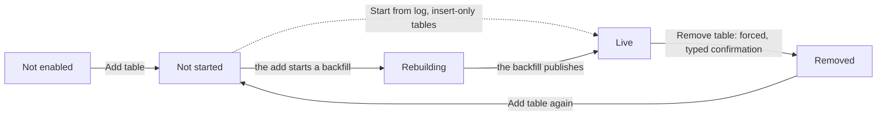
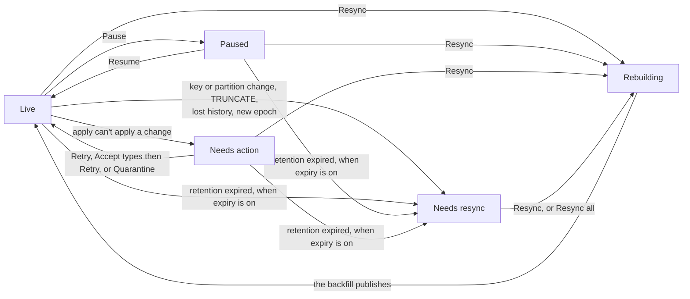

# Tables: states, membership, held states and source DDL

The states a table moves through, which tables a source mirrors, what holds a table, and what each source DDL change does to its mirror.

## Table states

Each table you replicate is in one of the states below. The diagrams show what moves it between them,
and the table after them shows what the Dive displays in each state and what to do.

### The normal path

A table the DBA has put in the publication shows as **Not enabled** until it's added. Adding it
starts it at **Not started**. Add needs the table to be in the publication first.

### When something needs attention

**Your mirror table stays queryable in every state.** While a table is held, paused or rebuilding,
the mirror keeps the rows it had at its last applied change. A rebuild builds a new copy alongside
the old one, and replaces the old one in a single step when it publishes.

| State | What the Dive shows | What it means | What to do |
| --- | --- | --- | --- |
| Not enabled | Not enabled | The table is in the publication, but it was never added. | Add it to start replicating it ([Table membership](#table-membership)). |
| Not started | Needs action (Rebuilding once its backfill runs) | The table was added, and its first load hasn't run yet or was refused. | Let the backfill Flight start its first copy (or run the table-action Flight's `start-snapshot`), or Start from log for an insert-only table. |
| Rebuilding | Rebuilding | A backfill is loading the table from a snapshot, then catching it up from the change log. | Nothing. If it fails, the table keeps the state it had before, and the Dive shows the error. |
| Live | OK, Stale or Waiting | Apply is keeping the mirror current. **OK:** caught up. **Stale:** further behind than the apply staleness limit. **Waiting:** the source's sync has stopped, and the cause shows on the source. | Nothing for OK. For Stale or Waiting, look at the source. Stale turns into Needs action after 24 hours behind. |
| Paused | Paused | The owner paused apply for this table. The change log keeps its changes, up to the retention limit. | Resume. The Dive shows Needs action when the pause's retention runs out within 24 hours ([retention.md](retention.md#consumer-expiry)). |
| Needs action | Needs action (Rebuilding while its resync runs) | Apply stopped at a change it can't apply safely. The hold code says why ([operations.md](operations.md#hold-codes)). | The hold code's fix: Retry after a repair, Accept types then Retry, Quarantine a poison unit, or Resync. |
| Needs resync | Needs action, or Queued after a slot recovery, or Rebuilding while its resync runs | The mirror can't be caught up from the log any more: its key or partitions changed, the table was truncated, history was lost, the source moved to a new epoch, or retention expired. | Resync this table, or Resync all after a slot recovery. |
| Removed | Not shown | The table was removed. Its mirror and its logged changes are kept. | Add it again to replicate it (it reloads). |

Retention expires a table only when expiry is on ([retention.md](retention.md#consumer-expiry)).

**Source-table holds.** When the source table is dropped, renamed, replaced or leaves the
publication, or stops being valid for capture, ingest holds it, whatever its state. The Dive shows
Needs action with the reason. These codes are: `dropped`, `renamed`, `replaced`, `unpublished`,
`invalid_kind`, `no_select`, `no_key`, `identity_not_full`, `leaf_invalid`, `publication_filter`,
`append_identity` and `append_partitioned`.

These holds clear by themselves once the source table is valid again. One exception: when a
validation hold clears on a table with a key (`invalid_kind`, `no_select`, `no_key`,
`identity_not_full`, `leaf_invalid`, `publication_filter`), the table moves to Needs resync, because
changes made while it was invalid can't be trusted. A table with a source-table hold can also be
removed without force.

**Hold codes by state** (the full list, with each code's fix, is in
[operations.md](operations.md#hold-codes)):
- **Needs action:**
  - `schema_changed`, `type_changed`, `source_mismatch`, `poison`, `missing_baseline`,
    `incomplete_insert`, `unsupported_change`, `key_cell`, `key_change_ambiguous` and
    `pin_invariant`;
  - for insert-only tables, `append_update`, `append_delete`, `append_keyed_frames` and
    `partitions_changed`.
- **Needs resync:**
  - `key_changed`, `epoch_changed`, `history_lost`, `truncate` and `retention_expired`;
  - from the catalog check, `pk_replaced`, `partitions_changed`, `column_default_fill` and
    `column_rewrite`.
- **Paused:** `paused`.
- **Not started:** `not_started`.
- **Not enabled:** `unmanaged`.
- **Removed:** `removed`.
- **Source-table holds** (any state): `dropped`, `renamed`, `replaced`, `unpublished`, `invalid_kind`,
  `no_select`, `no_key`, `identity_not_full`, `leaf_invalid`, `publication_filter`, `append_identity`
  and `append_partitioned`.

**Insert-only (keyless) tables differ:**
- **They can start from the log**, with no snapshot: Start from log takes Not started straight to
  Live. Or they can start from a snapshot.
- **An UPDATE holds the table as Needs action** (`append_update`). So does a DELETE
  (`append_delete`), unless `ignore_deletes` is set.
- **A TRUNCATE is applied, not held.**
- **A partition change is Needs action** (`partitions_changed`), fixed by Start from log or Resync.
- **Resync all and Queued skip them.** Each one is resynced on its own.
- **The Dive shows Rebuilding during a re-snapshot**, which runs alongside the held mirror.

## Table membership

The registry (`cdc_internal.<source>.tables`, keyed by OID) says which tables a source
captures, and which tables apply and backfill cover. `CDC_TABLES` is optional after the
first registration: when set, it's a declaration checked against the registry
that also restricts apply and backfill to its tables.

**Each run classifies every registered table by OID:**

| Found | Held reason | Effect |
| -- | -- | -- |
| its OID, under its name | none | captured |
| no OID | `dropped` (or `replaced`, if another table has the name) | held |
| its OID, another name | `renamed` | held; its changes keep being logged and its key tracked |
| its OID, not in the publication | `unpublished` | held |
| its OID, failing a per-table check | see below | held; after the DBA's fix, a resync |

**Per-table checks** (preflight's checks about one table) hold that table and never
the source:

| Held reason | Check |
| -- | -- |
| `invalid_kind` | not an ordinary or partitioned table |
| `no_select` | the replication role lost `SELECT` |
| `no_key` | no primary key and no replica identity index, or `REPLICA IDENTITY NOTHING` |
| `identity_not_full` | TOAST-capable columns without `REPLICA IDENTITY FULL` |
| `leaf_invalid` | a partition leaf without a key, or a TOAST leaf without FULL identity (the detail names the leaf) |
| `publication_filter` | a row filter or column list on that table, PostgreSQL 15+ (the detail names the kind, never its SQL) |

- While held, the table's changes keep being logged, but under a broken identity they
  may be incomplete.
- **Refused at registration, held afterwards:** a table failing a check when the source
  is first registered refuses the whole preflight. After that, the check runs at the start
  of every ingest run and holds only that table.
- **The detection window.** A DBA change made during a run (for example REPLICA
  IDENTITY FULL to DEFAULT) is seen at the next run's start. The table's
  `key_checked_lsn` then freezes at its last verified unit end, which can be the end of
  the run during which the change happened. Changes logged up to that cut may carry
  DEFAULT-identity images; the fold handles them as it does any partial image
  (inheriting unchanged cells from the mirror row, or holding `needs_action` when the
  row is missing).
- **When the check passes again,** the hold clears and a new key version cuts at that
  frozen unit end. Apply may finish the units up to the cut, never
  one logged during the hold, then holds `needs_resync`. A backfill then rebuilds the
  mirror from a snapshot, replacing everything applied in the window.
- **A backfill running when its table is held fails** before catch-up and
  publication (and while waiting for ingest's key confirmation, which a held table
  never gets).
- **Source-wide checks still stop the source:** the endpoint, the connection, server
  version, `wal_level` and encoding, session value formats, the replication
  capability, primary (not a read replica (standby)), the heartbeat (shape, privileges, membership),
  the publication's own settings, the slot, the registration's identity and binding,
  and an unknown `CDC_TABLES` name.
- **A first registration** still refuses any invalid table: nothing is captured yet.

- **A hold is reported, never a failure:**
  - ingest lists it in its JSON line (`held`, with reason and detail) and in the Flight
    Explainer's `held` check, and exits normally;
  - apply reports the table as `source_missing` and exits 0 for it (any other
    `needs_action`/`needs_resync` still exits 2);
  - backfill refuses to start a generation for it.
- **The hold is durable:** `held_reason`, `held_detail`, `held_since` (first seen) and
  `held_checked_at`. It clears if the table returns under its name with its OID (a
  rename reverted).
- **A publication member nobody registered** (a recreated table, a DBA's addition) is
  registered `unmanaged`: logged, never applied, and reported as "run add-table, or
  remove it from the publication". It never stops the source.
- **`CDC_TABLES`:**
  - a removed or former name is ignored and reported (`stale`);
  - an unknown name is refused ("run add-table");
  - an active table it omits is captured and reported (`undeclared`).

**Operator commands** (`cdc-flight-tables`, run outside a Flight; see
[flights.md](flights.md)):
- **`remove --table s.t [--force]`:** a held table, or with `--force` one that still
  exists. It refuses while a backfill generation is active.
  - It fences the table's apply runs (its apply lease), then marks the row `removed`
    and releases its retention pins in one guarded transaction.
  - The row stays, so changes still in the WAL decode (logged, never applied). The
    mirror table is kept.
- **`add --table s.t`:** the table must pass preflight's per-table checks and already be
  in the publication; otherwise it refuses with the `ALTER PUBLICATION … ADD TABLE`
  fix. Then, by OID:
  - **new:** registered, and a backfill builds its mirror;
  - **`unmanaged`:** adopted, its logged changes kept. Its tracked key stays the one
    registered then; if the table gained or changed a key since, ingest records that
    as a key version before a backfill can start ("run ingest, then retry");
  - **`removed`:** re-activated with a new key version (a backfill);
  - **a `renamed` hold:** relabelled in place. The mirror's apply state and table are
    renamed first, under its apply lease, then the registry. The OID's log never
    broke, so the mirror resumes from its checkpoint with no resync.
  - **Another OID holding the name** (`dropped`/`replaced`) is retired in the same
    transaction. The new table's generation then replaces that mirror under the same
    name, under the retired relation's apply lease, and the old mirror stays queryable
    until then.
- Both are idempotent: a retry reports `already`, or finishes a relabel interrupted
  between its two steps.

## Held states

A held table keeps its checkpoint, and later runs do not touch it. Raw capture
continues in the log. Nothing is skipped silently.

| Cause | State | What is applied |
| :---- | :---- | :---- |
| Unsupported schema transition, absent or non-value identity cell, replica identity NOTHING | `needs_action` | Every unit before the blocking commit's unit (`blocked_unit_start_lsn`); `blocked_commit_lsn` names the commit |
| Value rejected by the mirror type or constraint (poison) | `needs_action` | Every unit before the poison unit. Bisection by units with rolled-back probes finds it; `blocked_commit_lsn` names the table's first commit in that unit |
| Partial image (unchanged columns) for a row the mirror lacks | `needs_action` | Nothing from that batch |
| TRUNCATE, or source epoch change | `needs_resync` | Every unit before the TRUNCATE's unit |
| Source key changed after the mirror's key version (any identity, including FULL, and including a change that was later reverted) | `needs_resync` | Every unit up to the cut: the last unit end at which ingest confirmed the mirror's key |

Quarantine (skipping the one whole unit of transactions the table is held before), pause,
resume, retry and resync are operator actions ([operations.md](operations.md#action-flights),
[runbooks.md](runbooks.md)). A resync generation replaces
a held table. Only the error class is recorded for poison batches, never
values.

## Source DDL

What each kind of source DDL does to the table, as tested:

| Source DDL | What happens, and what to do |
| -- | -- |
| ADD COLUMN | mirror column added, values carried |
| ADD COLUMN … DEFAULT on existing rows | `needs_resync` at the last verified cut, before the ALTER (the catalog check sees `atthasmissing`; a volatile default rewrites the table, also held); resync. An append table: a warning only, its existing rows stay NULL |
| ALTER COLUMN TYPE, mirror type changes | `needs_action` exactly at the first transaction after the ALTER; resync |
| ALTER COLUMN TYPE, mirror type unchanged, source type changed (`text` → `varchar(n)`, `char(n)` → `text`, a `USING` into another type) | `needs_action` at the first transaction after the ALTER (reconcile compares the source type OID and typmod); resync, or `accept-types` when no value changed. A widening that keeps every value (a longer or unlimited `varchar`, `varchar` → `text`, a wider integer) is kept, with no hold |
| ALTER COLUMN TYPE to the same type with `USING` (a same-type rewrite) | **not detected**: existing mirror rows keep their old values; resync to correct it |
| RENAME COLUMN, DROP COLUMN | `needs_action` at a transaction that writes rows on both sides of the DDL, with none of it applied; resync |
| ADD / DROP PRIMARY KEY, seen by an ingest run | `needs_resync` at the key's last confirmed boundary; resync re-keys |
| PRIMARY KEY changed and restored between two ingest runs, REPLICA IDENTITY FULL | `needs_resync` at the last verified cut: the catalog check sees a new primary key constraint (REINDEX, VACUUM FULL and CLUSTER keep it); resync |
| ATTACH / DETACH PARTITION (publish_via_partition_root) | `needs_resync` at the last verified cut (the catalog check compares the leaf set); resync. An append table: `needs_action`; start-from-log. A leaf detached and re-attached between two runs isn't seen |
| TRUNCATE | `needs_resync`; resync |
| DROP TABLE | that table holds (`dropped`), the rest of the source runs and the slot advances; `remove-table` releases it |
| RENAME TABLE | that table holds (`renamed`) while its changes keep being logged; `add-table` under the new name relabels it in place, with no resync |
| DROP + CREATE under the same name | the old table holds (`replaced`); once published, the new one is logged as `unmanaged`; `add-table` adopts it, and its backfill replaces the old mirror under the same name |
| New table | logged as `unmanaged` once published; `add-table`, then backfill |
